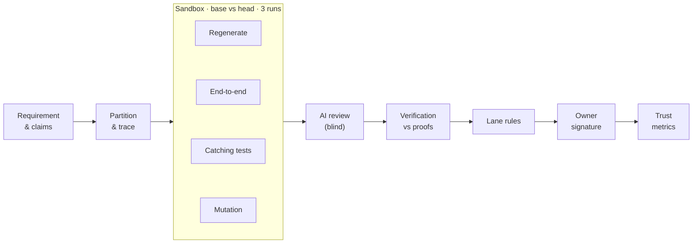

# The Change Passport

**AI code review you can sign for.** A concept and reference implementation for reviewing code written by AI agents, so that a named human can accept a change without reading all of it and stay accountable for it.

*Junction 2026, Tieto challenge "Earned Trust in AI Code". A reference implementation that illustrates the concept, not a product. All people named are synthetic.*

> **The LLM proposes, execution proves, rules decide, a named human signs.**

## The idea

Agents now write code faster than humans can review it. Reading every line does not scale, and letting an AI approve removes accountability. We change **what** is reviewed: every agent-written change travels with a **passport** that states

- what was asked: acceptance criteria locked by a human;
- what the agent claims it did;
- a **proof for each claim**, obtained by running the code before and after the change in a sandbox, not by asking an AI;
- what the AI reviewer **refused to decide**, because it belongs to a person;
- **how much a human must read**, as decided by explicit rules.

A named owner reads what the risk requires, answers the AI's refusals, and signs a bounded attestation (checked, not checked, risk accepted) bound to the commit.

## The pipeline



| Step | What it does |
|---|---|
| Requirement & claims | A human locks 3–6 acceptance criteria; the agent declares its claims. |
| Partition & trace | A versioned policy sorts the diff into zones; each hunk is linked to a claim, and orphan code is always shown. |
| Regenerate | Generated files are rebuilt from source and compared byte for byte. |
| End-to-end | A real user project is built and run against the old and the new version. |
| Catching tests | A separate LLM writes throw-away tests from the criteria only (never the agent's code) and runs them old vs new. |
| Mutation | Each agent change is reverted in turn: do the tests notice? |
| AI review | A read-only reviewer, blind to the proofs, must quote the code; it refuses product, API and risk decisions. |
| Verification | Each AI finding is checked against the code and the proofs: confirmed, rejected, opinion, or missed. |
| Lane rules | Deterministic rules choose green, orange or red. The AI can raise risk, never lower it. |
| Owner signature | Posted on the pull request as a pending status until the named owner signs. |
| Trust metrics | Seeded bugs, random counter-review and per-zone trust, withdrawn after an escape. |

**On the sample change (REQ-2297, 237 files written by an agent):** all 169 tests were green, yet execution against the criteria found 2 user-breaking regressions. The owner had to read **46 of 1,392 lines**. The AI reviewer's 4 findings were all confirmed, it missed 1 issue, and it refused 6 decisions.

## Repository layout

| Path | Content |
|---|---|
| [`livrable/`](livrable/) | **The deliverable** (English): [concept card](livrable/00-concept-card.md) ([PDF](livrable/concept-card.pdf)), [overview](livrable/README.md), workflow, each step, principles and trade-offs, measurement, limits and failure modes, decision log, sources, adoption, lessons log. `livrable.html` bundles every page into one file. |
| [`public/`](public/) | **The demo site**: a technical walkthrough of the pipeline, step by step (Mermaid diagrams, stack, rationale, result). Static, works offline; deployable as is (`vercel.json`). |
| [`factory/`](factory/) | **The reference implementation** (Python) that produced every number above. See [`factory/README.md`](factory/README.md). |
| [`notes/`](notes/) | Working notes: research report, analyses, measurements, early concept drafts. |
| [Pull request #1](../../pull/1) | **The concept in a real PR flow**: the agent's REQ-2297 branch (`ju26-issue-2297`) against its base (`sample/base`), with the passport posted as a comment, a `passport/lane` status, and a `passport/owner-signature` status that stayed pending until the named owner signed (here: sent back, bound to commit `a0aa5ab2`). These two branches hold the sample code only; the project is on `main`. |

## Run it

**Demo:** open `public/index.html` in a browser. Use ← / → to move between steps, N to show speaker notes, A to play automatically.

**Deliverable:** read [`livrable/README.md`](livrable/README.md), or open `livrable/livrable.html`.

**Reference implementation** (optional; it reproduces the passports):

- Requirements: Python 3 with `pyyaml` (and `markdown-it-py` to rebuild `livrable.html`), .NET SDK 8, git. The `claude` CLI is needed for the AI review and catching-test steps, and the `gh` CLI for the pull-request flow.
- Clone the challenge repository into `upstream-repo/` (it is git-ignored), then point `factory/sandbox.yaml` at your local .NET SDK and git worktrees.

```bash
cd factory
python3 pipeline.py --req REQ-2283              # the whole chain, live, on one change
python3 replay.py E3 --req REQ-2297             # replay one proof, base vs branch
python3 build_demo.py                           # rebuild public/index.html
cd ../livrable && python3 build_html.py         # rebuild livrable.html and the concept card
```

The input is the challenge repository `te-industry-tech-office/junction26-messagepack-csharp`, a copy of MessagePack-CSharp with four agent-written branches (`ju26-issue-2283`, `2234`, `2129`, `2297`).
