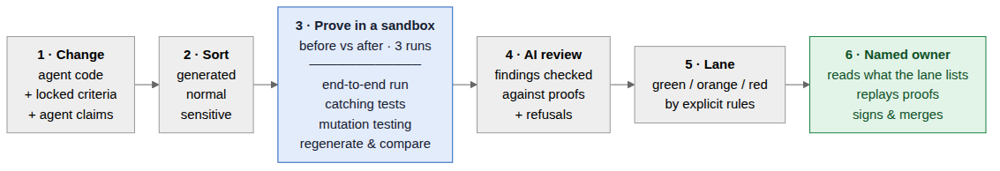
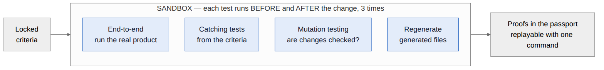
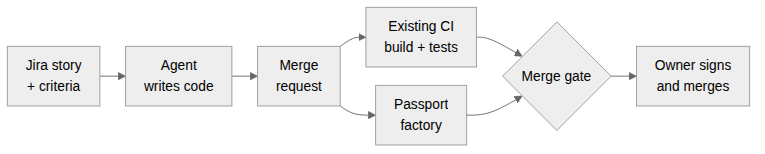

# 2. The workflow

## The path of a change

| Step | Question it answers | Output | Details |
|---|---|---|---|
| 1 Declaration | What was asked, and what does the agent claim? | Locked criteria + claims | [03-steps/a](03-steps/a-requirement-and-claims.md) |
| 2 Split | What kind of code changed, and which part must a human see? | Zones, links, reading contract | [03-steps/b](03-steps/b-split-and-reading-contract.md) |
| 3 Evidence | Is each claim true, independently of the agent? | Typed evidence, replayable | [03-steps/c](03-steps/c-evidence.md) |
| 4 AI review | What might a careful reviewer flag? | Verified findings | [03-steps/d](03-steps/d-ai-review-and-refusals.md) |
| 5 Refusals | What must a person decide? | Refusal register | [03-steps/d](03-steps/d-ai-review-and-refusals.md) |
| 6 Lane | How much human reading is needed? | Green / orange / red + reasons | [03-steps/e](03-steps/e-lanes-and-signature.md) |
| 7 Signature | Who accepts, based on what? | Bounded attestation | [03-steps/e](03-steps/e-lanes-and-signature.md) |
| 8 Measure | Is the trust deserved? | Metrics, trust register | [05-measurement.md](05-measurement.md) |

## Step 3 in detail — the evidence factory

Everything in this box runs in a **disposable sandbox** (no secrets, no outbound network), on the **base** and on the **branch**, **3 times each**. Every result can be **replayed with one command** by the owner.

How every executed scenario is classified (end-to-end runs and catching tests):

| Before the change | After the change | Meaning | What happens |
|---|---|---|---|
| passes | **fails** | **Catch**: a behaviour changed | Regression → red, or a decision → refusal |
| fails | **passes** | The requirement is implemented | Counts as proof for its criterion |
| fails | fails | Criterion not met, or the test is wrong | Shown to a human |
| passes | passes | No difference | No information |
| changes between the 3 runs | | **Unstable** | Never counts as proof |

| Evidence | What it proves | Strength |
|---|---|---|
| End-to-end run of the real product | The product behaves as the criteria require | Strongest |
| Catching tests from the criteria | A behaviour changed, or a criterion is met | Strong, independent of the agent |
| Mutation testing on the diff | Whether the delivered tests actually notice the changes | Measures the tests |
| Regenerate & compare | Generated files are reproducible from their source | Strong for generated files |
| Agent's own tests (fail before / pass after) | The agent's tests detect its change | Weakest: not independent |

## Roles

| Role | Who | Responsibility |
|---|---|---|
| **Agent** | The coding agent | Writes the change and **declares its claims** |
| **Factory** | Rules + tools + a reviewer model of another family | Splits, proves, reviews, refuses, routes. **Never approves, no merge rights** |
| **Owner** | The named person for the touched zone (CODEOWNERS) | Decides refusals, reads what the lane requires, **signs, merges, stays accountable in production** |
| **Policy guardian** | Tech lead / quality lead | Owns the policy and the trust register; reviews metrics weekly; policy changes go through review |

## Three lanes — a human signs in every lane

| Lane | When | Human work | Typical time |
|---|---|---|---|
| **Green** | Only mechanical/ordinary code in a *trusted* zone, every claim proven, no refusal | Read the passport summary, sign. 10% of greens are drawn at random for a full counter-review | 1–2 min |
| **Orange** | Sensitive zone, unproven claim, orphan code, zone not yet trusted | Answer two questions, read the hunks in the reading contract, decide refusals, sign | 10–30 min |
| **Red** | A criterion contradicted by evidence, public API, major refusal, change too large | Send back to the agent with the evidence, or full reading and written decision | depends |

## What is deterministic, what is not

The design keeps every non-deterministic part **advisory** and every decision **deterministic and explainable**.

| Part | Deterministic? | Consequence |
|---|---|---|
| Sorting into zones, traceability, reading contract | Yes: versioned rules | Same change → same reading contract |
| Executed evidence (base vs branch) | Made stable: 3 runs per side; any difference → "unstable", never counts as proof | A flaky test cannot create a fake catch |
| AI review (findings, refusals) | **No**: two runs on the same change can differ | Each finding is checked against the proofs: quote not found → rejected; contradicted by a proof → "opinion — proofs disagree"; unverified → "opinion" |
| Lane | Yes: rules over evidence + refusals | The AI can only **add** refusals, so a different AI run can raise the lane, never lower it |
| Signature | Human | Bound to the commit and to the passport fingerprint |

Observed: on one change, a live AI run raised a user-visible refusal that a previous run did not, and the lane went from orange to red. We did not tune the rules to get the earlier lane back: the variance can only cost a review, not let a change through.

## How it scales

| Cost | Grows with | How it is kept bounded |
|---|---|---|
| Sorting, traceability, lane | Diff size | Seconds; pure rules |
| Executed evidence | Number of scenarios × build time | Base and branch run in parallel; sandboxes are disposable and run on the existing CI runners; base-side results can be cached per base commit and reused by every PR on it; the existing CI results are read as evidence, not re-run (target form) |
| AI review | Diff size | One read-only call per change, blind to the evidence; no tools, no merge rights |
| Human reading | **Risk, not diff size** | Green: summary only; orange: the reading contract (3–17% of changed lines on our samples); red: send back |
| Per-repository setup | Once | Policy zones (like CODEOWNERS) and one end-to-end harness per product type |

Measured on our reference implementation (one laptop, warm build): the whole chain on a 4-file bug fix took about 2–3 minutes, most of it the base/branch runs.

## Where it plugs into an existing pipeline

The passport is an **extra layer between "the agent is done" and "a human approves"**. It replaces nothing.

- **Merge gate**: an external status check (GitLab) or a required check (GitHub) that stays red until the attestation is signed by the CODEOWNER of the touched zones.
- **On-premises**: every component runs locally (scripts, git, the project's own build tool); no SaaS is required — a hard constraint for regulated or mission-critical teams such as Tieto's telecom product teams.
- **Jira**: the requirement ID and the hash of the locked criteria are stored on the story; the signed attestation is attached to the merge request.
