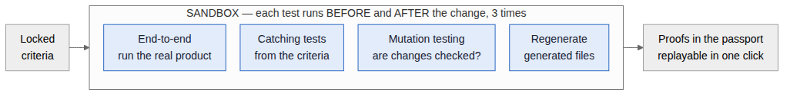
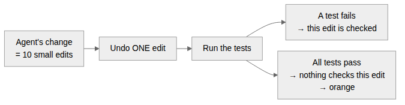

# Step 3 — Independent evidence

The core idea: **reading tells you what code says; running it tells you what it does.** Every piece of evidence runs on the **base** (before the change) and the **branch** (after), in a disposable sandbox, and can be **replayed in one click**.

How every executed scenario is classified (end-to-end runs and catching tests):

| Before the change | After the change | Meaning | What happens |
|---|---|---|---|
| passes | **fails** | **Catch**: a behaviour changed | Regression → red, or a decision → refusal |
| fails | **passes** | The requirement is implemented | Counts as proof for its criterion |
| fails | fails | Criterion not met, or the test is wrong | Shown to a human |
| passes | passes | No difference | No information |
| changes between the 3 runs | | **Unstable** | Never counts as proof |

## Evidence ladder (strongest first)

| Evidence | What it proves | Independent of the agent? |
|---|---|---|
| **End-to-end run in a sandbox** against the criteria | The product really behaves as required | Yes, if scenarios come from the criteria |
| **Acceptance / catching tests** from the criteria, base vs branch | A behaviour changed, or a criterion is met | Yes |
| **Fail-before / pass-after** of the agent's own tests | The agent's tests detect its change | No — weakest executed evidence |
| **Mutation score** of the delivered tests | Whether tests notice the changes at all | Yes (measures the tests) |
| **Regenerate & compare** generated files | Generated output is reproducible | Yes |
| **AI finding without execution** | Nothing yet — an opinion | Labelled "opinion" |

## 3.1 End-to-end execution in a sandbox

**What it does.** The change is built and run as a user would: a library is consumed by a real project per target; a service is started with an ephemeral database and called; a UI is driven in a browser. Each criterion gets *passed / failed / not tested* with artifacts (logs, traces, screenshots, video).

**Why.** An agent fails differently from a human: its tests and the existing CI can all be green while users break. OpenAI (Codex tasks in isolated containers, summaries citing test logs), Minitap (mobile QA agent, expected-vs-observed per criterion), Greptile TREX, Devin and Cursor (agents in VMs returning videos) all moved to execution evidence in 2026.

**Rule.** A green end-to-end run proves **only the criteria it covers**, and only if its scenarios were derived from criteria signed beforehand. "Not tested" stays visible and never counts as success.

**Generic or per repository?** Principle generic; **one harness per product type** (library, service, UI) — a real setup cost.

## 3.2 Catching tests generated from the criteria

**What it does.** A separate model reads **only the criteria and the list of touched files** (not the agent's code comments or tests) and writes disposable scenarios. Each runs on base and branch. *Pass → fail* is a catch; *fail → pass* proves implementation; *fail → fail* goes to a human (criterion not met, or invalid test). Tests are never committed.

**Why.** Meta's Just-in-Time tests (FSE 2026): diff-aware generated tests found 4× more candidate bugs than hardening tests; in production, 60% true positives, 74 serious bugs blocked in H1 2026, −20% incidents. Humans stay *on the loop*: they set criteria and review aggregated results.

**Why the generator must not read the agent's comments.** If it does, it inherits the agent's mistakes (we observed exactly this: a generated scenario repeated the agent's false premise).

## 3.3 Mutation testing scoped to the diff

**What it does.** Each change of the agent is reverted one at a time (and, in the target form, finer mutants are injected on changed lines, e.g. Stryker for .NET); we record which mutants the delivered tests notice. A change no test notices pushes the lane to orange.

**Why.** Coverage says code was *executed*, not *checked*. Google shows diff-scoped mutants in code review at scale (~17 M mutants, arXiv 2102.11378); Meta's ACH generates tests that kill surviving mutants (73% accepted by engineers).

**Cost control.** N mutants × test suite is expensive → only in orange/red lanes.

## 3.4 Guards on the evidence itself

| Guard | Why |
|---|---|
| **3 runs per side**; a changing result is "unstable" and never proof | A flaky test would create fake catches (Meta TestGen-LLM keeps only stable tests) |
| **Assertion strength check**: no assertion, trivial assertion, tautology (`Count >= 0`), text-only checks are flagged | The weak link of LLM-written tests is the oracle, not coverage (Ernst et al., ASE 2025) |
| **Test ↔ criterion link**: each test cites the criterion it covers; a criterion is "supported" only if a linked test passes | A link is not a proof; only a linked, passing execution is (ReqToCode, 2026) |
| **Environment claims are evidence too**: if the agent asserts something about the platform ("X is not available on target Y"), it must be checked | Agents encode false premises in code, docs and tests at once |

## 3.5 One-click replay

**What it does.** Every executed evidence can be re-run by the owner on base and branch, side by side; the scenario is editable to explore; each replay is recorded in the attestation.

**Why.** *"Trust is built on evidence a person can check and own"* (challenge brief). A proof you can replay yourself is one you can sign. Replay.io's "rerecording" (same interactions before/after) is the closest industry practice.

**Generic or per repository?** Generic; uses the same harnesses as 3.1–3.3.
