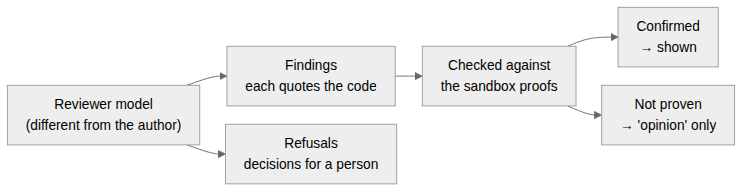

# Steps 4 & 5 — AI review and the refusal register

## 4. AI review

**What it does.** A reviewer model reads the change with full repository context and the criteria. It must **quote the diff before concluding**, classify each hunk on a **closed grid** (safe categories vs risk signals — one risk signal escalates), and list what it refuses to decide. A refuter tries to disprove each finding; surviving findings are checked against executed evidence. No style or naming remarks.

**Why each design choice.**

| Choice | Reason | Source |
|---|---|---|
| Different model family from the author | Judges favour their own family (+3 to +8 pts); models correct others' errors far better than their own | arXiv 2609.17857; arXiv 2606.05976 |
| Quote before concluding | Forces grounding in the code; Vercel's classifier must list evidence quotes before its verdict | Vercel engineering blog (Apr. 2026) |
| Closed grid, one risk signal escalates | Turns the LLM into a classifier, not an essayist; Meta RADAR accepts only if every hunk is in a safe category | Meta RADAR (arXiv 2605.30208) |
| Refuter before publication | Adversarial agents removed ~80% of candidate findings before release; watch for *false consensus* | Refute-or-Promote (arXiv 2604.19049) |
| Checked against evidence | AI reviewers reach 50–60% F1 on real PRs; precision first or developers stop reading | Martian Bench 2026; Uber uReview |
| No style remarks | Style noise is the first reason teams switch off AI reviewers | Graphite, Cloudflare "What NOT to flag" |

**What the AI review is not.** It is **advice with evidence, never the approval** (challenge brief). An unconfirmed finding is labelled "opinion" and cannot block alone; an empty AI review is not a green light.

**Generic or per repository?** Generic.

## 5. The refusal register

**What it does.** A catalogue of decision types the AI never takes, even when confident. Each refusal names the question, the reason, and the person who decides:

| Decision type | Why the AI refuses | Default decider |
|---|---|---|
| Public API shape and naming | Irreversible once published | API owner |
| New public identifiers (diagnostic IDs, error codes) | Permanent | Maintainer |
| User-visible behaviour change | Product intent | Owner |
| Compatibility / supported targets scope | Product and support commitment | Owner |
| Accepting a security risk | Accountability | Owner + security |
| Any claim without available evidence | "I cannot prove it" is an answer | Owner |

Refusals are raised from three sources only: **policy zones** (e.g. public-API zone touched), **evidence** (e.g. an execution shows user-visible behaviour changed), and **the AI reviewer**. A major refusal forces the red lane.

**Why.**
- The challenge asks to show *what the AI refused to decide, and why*.
- Every vendor admits the same blind spots — architecture, cross-system effects, product intent (Cloudflare, Intercom, Mary Shaw keynote 2026) — so they must be routed, not guessed.
- An AI that never refuses anything is a warning sign, not a strength (see measurement).

## Securing the factory itself

The AI reviewer reads attacker-controllable content (PR titles, comments, instruction files, images). 2026 incidents: CI secrets exfiltrated through PR titles via AI review actions (*Comment and Control*, 2 CVEs), an AI reviewer auto-approving malicious code because of a spoofed Git identity, hidden instructions in images (*GhostCommit*).

| Rule | Effect |
|---|---|
| PR content is untrusted data | Never treated as instructions |
| Reviewer is read-only, no secrets, no outbound network | A hijacked reviewer can only produce a passport, which a human reads |
| No approval and no merge rights for any AI | Approval stays human by construction |
| Declared author identity never lowers risk | Defeats identity spoofing |
| Changes to CI, build scripts and agent instruction files are a sensitive zone | These are the 2026 attack paths |
| Evidence runs in a disposable sandbox | PR-provided configs cannot touch the factory |
