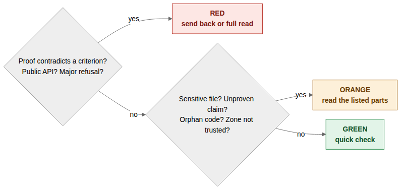
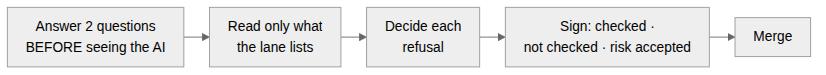

# Steps 6 & 7 — Lanes and the signature

## 6. Lanes decided by rules

**What it does.** A deterministic verdict engine (ordered rules, testable code — not a model) turns evidence, zones, refusals and the trust register into a lane, and lists every reason in plain words.

**Why.**
- Rewind's "Diff Vader": specialised LLM reviewers produce findings, **"ordinary, unit-tested code, not a model"** decides. Meta RADAR: conjunctive funnel where any failure goes back to a human.
- Asymmetry by design: *a false orange costs one review; a false green lets risky code ship* (Vercel).
- Thoughtworks Technology Radar (vol. 35, Nov. 2026) puts **risk-tiered human oversight** in *Trial* and warns against "human-in-the-loop theater" where everything gets the same attention.

**Difference with industry practice.** Meta, Vercel, Intercom and Rewind let the AI approve the low-risk tier. **We do not**: green still requires a light human signature, because the challenge requires a named human per change and because no company publishes who answers when an auto-approved change breaks.

## Trust earned per zone

| State | Rule |
|---|---|
| New | Default; no green lane in this zone |
| Trusted | ≥ N signed changes over 60 days, 0 reverts/incidents, ≥ 90% agreement in random counter-review |
| Suspended | Any revert or incident linked to a passport of the zone; the factory gets a new rule or test for what it missed, then the zone requalifies |

**Why.** Meta RADAR grants autonomy **per agent "recipe"** from 60 days of history, with daily caps and a denylist after incidents. The challenge brief: *"Trust is earned per area, from track record, and withdrawn after escapes."*

## 7. The signature

**What it does.**
1. **Two questions before the AI view** (orange/red): *Do the criteria reflect the issue? What must not change for users?* The page hides the AI analysis until they are answered.
2. The owner reads the reading contract, ticks each hunk, decides each refusal.
3. The owner signs a **bounded attestation**:

| Section | Content |
|---|---|
| Checked — by whom or what | each item with its source: rule, sandbox run, AI + verification, "me (reading)" |
| Not checked — why | everything without evidence, with the reason |
| Decisions | each refusal and the owner's decision |
| Residual risk accepted | in the owner's words |
| Identity | name, date, passport fingerprint, commit |

4. The **owner merges**. The signature is bound to the commit: a new commit invalidates it.

**Why each choice.**

| Choice | Reason | Source |
|---|---|---|
| Questions before the AI view | Displaying an AI review narrows reviewers' attention; explanations raise acceptance whether the AI is right or wrong; cognitive forcing reduces over-reliance | Tufano ICSE 2025; Bansal CHI 2021 (confirmed 2026, arXiv 2607.08885); Buçinca CSCW 2021 |
| Bounded attestation, not "approve" | Avoids the moral crumple zone; the owner answers for what they saw, not for everything | Elish 2019; challenge brief "What the owner signs" |
| Owner merges, not the bot | "Human merge authority is the trust anchor" (Ona); auto-approve is not auto-merge (Rewind); compliance needs an auditable change process | Ona, Rewind, Vercel (2026) |
| Signature bound to the commit | You cannot sign a version other than the one reviewed | CodeRabbit Change Stack, Devin Review (2026) |

**Limits.** Friction: 1–2 minutes even in green, more in orange. We reserve the questions for orange and red.
