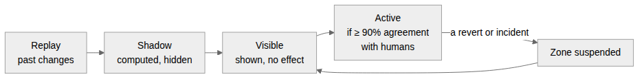

# 5. Measuring trust

The judges' question: *do reverts and incidents stay flat while review time falls; are AI findings real and accepted; what is time-to-merge; what share goes to humans?* Trust must be **measured**, and lighter review must be **earned**.

## Progressive activation

Inspired by Vercel (shadow → visible → enforced, with kill switches defined in advance: reverts > 3× baseline, rollbacks > 3× baseline, negative team sentiment) and Rewind (simulation on ~3,000 historical PRs, one week in shadow, activation above 90% agreement with humans).

## Dashboard

| Judges' question | Metric | Why this metric |
|---|---|---|
| Do reverts/incidents rise as review time falls? | Reverts and incidents **per lane and per zone**, linked back to the passport; time spent per lane | Aggregate numbers hide where trust is misplaced |
| Is the comparison fair? | **Random counter-review**: 10% of green changes drawn at random and fully reviewed; agreement rate | All published industry baselines (Meta, Vercel, Intercom) are non-randomised and biased by selection |
| Are AI findings real and accepted? | % confirmed by evidence; % followed by a fix; "Incorrect?" clicks | Industry reference: 36–39% of AI comments lead to a change vs 44% for humans (Atlassian, CodeRabbit study) |
| What does the factory miss? | **Canary bugs** injected continuously from a library of typical agent defects: % caught, per lane | The only way to measure recall without waiting for incidents |
| Are tests strong? | Mutation score of delivered tests; share of criteria with a passing linked test | Coverage and green tests say little about agent code |
| Are results stable? | Share of unstable evidence over 3 runs | Flaky evidence is not evidence |
| Time to merge | p50 / p75 per lane; signature time **measured**, not declared | Developers overestimate AI speed-ups (METR) |
| Share routed to humans | Green / orange / red split; lines to read ÷ lines changed | Shows where attention goes |
| Is the human really reading? | Required hunks opened; signatures faster than the reading time required | Detects rubber-stamping |

## Circuit breakers (defined before activation)

- A revert or incident linked to a passport → its zone is suspended.
- Counter-review agreement < 90% → green lane suspended globally.
- A canary bug passes as green → green lane suspended; the factory gets a new rule or test.

## What would make us distrust our own output

A canary passing green · a revert linked to a green passport · counter-review agreement dropping · signatures faster than the required reading · unstable evidence growing · an AI that never refuses anything · links that the owner keeps rejecting.

## What our reference implementation showed (illustration, not statistics)

| Observation | Value |
|---|---|
| On one 237-file agent change, lines a human had to read | 46 of 1,392 (3%) — the rest proven by regeneration or read through their source |
| Same change: agent's own tests | all green; they noticed 3 of the agent's 10 changes under mutation |
| Same change: independent evidence | 2 regressions for users found by execution against the criteria |
| AI reviewer, without seeing our evidence | 4 findings, all confirmed; 1 real issue missed |
| A second change (bug fix), using only generic steps | The issue's own repro, run end to end: crash on base, fixed on branch |
| Two bug-fix changes, generic steps only | Lines to read: 39 of 228 and 36 of 266; each fix proven by the issue's reproduction (crash before, works after) |
| The same change reviewed live by the AI, twice | Different refusals between runs; one run moved the lane from orange to red, never the other way |
| AI findings checked against proofs (live run) | 2 of 6 findings contradicted by an executed proof (e.g. "no round-trip test exists" while the proof runs one) |
| 8 seeded defects in our test bench | 8 flagged — optimistic, written knowing the rules |
