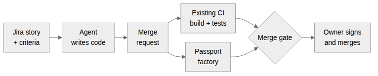

# 9. Adopting the passport on an existing project

**Short answer:** yes — the passport is designed as an **additive layer** on top of the pull-request flow a project already has. It **consumes** what the existing pipeline already produces (CI results, test suites, CODEOWNERS, branch protection, issue tracker) and adds what is missing (independent evidence, refusals, lanes, a bounded signature). Nothing existing is removed, and nothing changes for the team until the passport is activated zone by zone.

## What the passport reuses from the existing project

| Already in the project | How the passport uses it |
|---|---|
| **CI results** (build, unit, integration, lint) | Read as evidence for the branch; not re-run when already available |
| **Existing test suite** | Run on base and branch; target of mutation testing; source of "fail before / pass after" |
| **Snapshot / golden tests** | Act as the "regenerate & compare" proof for generated files |
| **Test helpers and verifiers** | Declared once in the policy so the assertion check recognises them |
| **CODEOWNERS** | Gives the named owner per zone and seeds the policy's sensitive zones |
| **Branch protection / required approvals** | Becomes the merge gate: an extra required check "attestation signed" |
| **Static analysis, dependency and secret scanners** | Deterministic inputs: findings raise the zone or create refusals |
| **Issue tracker (Jira, GitHub issues)** | Source of the requirement ID; stores the hash of the locked criteria and the signed attestation |
| **The CI build image** | Reused as the sandbox image, so evidence runs with the project's real toolchain |

## What is added once per repository

| Addition | Effort | Can start without it? |
|---|---|---|
| Policy file (zones, sensitive paths, verifier helpers) | Hours — mostly derived from CODEOWNERS | No |
| Merge-gate check + passport page | Hours — one CI job and one status check | No |
| Regeneration command for generated files | Minutes, if the project already has snapshot tests | Yes |
| End-to-end harness per product type (library consumer, service + ephemeral DB, browser) | Days per product type | Yes — fewer proofs, more reading |
| Catching-test harness template | Hours | Yes |
| Agent template that emits claims | Hours | Yes — without claims, all code is "orphan" and read |

The passport degrades gracefully: **without harnesses it still routes changes, shows refusals and records accountability — it just cannot reduce reading yet.**

## What changes for the team

- Agents must **declare claims** (Tieto's planning agent already writes a tracking file that can serve this purpose).
- For **new** work, a human writes 3–6 acceptance criteria; legacy requirements are not back-filled.
- Owners sign an attestation instead of clicking "approve".

## Cold-start realities on a brownfield project (and how we handle them)

| Reality | Effect | Handling |
|---|---|---|
| **No trust history** | No zone is trusted → no green lane at first | Expected; zones earn trust over 60 days |
| **Legacy requirements without criteria** | The passport can only route | Criteria only for new requirements |
| **Existing flaky tests** | Many results marked "unstable" | They never count as proof; the list of unstable tests becomes a quality backlog |
| **Long test suites** | Running base + branch × 3 is expensive | Base results are cached from the main branch's CI; mutation and repeated runs only in orange/red lanes; test-impact selection may *order* tests, never *skip* proofs |
| **Infrastructure-as-code, data migrations** | Hard to run end to end cheaply | Always a sensitive zone; evidence = dry-run / plan output on an ephemeral environment; acceptance of the risk is a refusal for a human |
| **External services, secrets** | The sandbox cannot call production | Mocks or recorded traffic (e.g. Keploy, Speedscale proxymock — on-premises), synthetic data; never production secrets |
| **On-premises constraint** | No SaaS allowed | Every component runs locally on the existing CI runners |

## Progressive rollout with zero disruption

| Phase | What the team sees | Exit criterion |
|---|---|---|
| **1 · Replay history** | Nothing — the passport is computed on the last N merged PRs | Lanes compared with what actually happened (reverts, incidents) |
| **2 · Shadow** | Nothing — passports computed on new PRs, hidden | Stable, no crashes, acceptable cost |
| **3 · Visible** | Passport shown on every PR, "Incorrect?" button, existing review unchanged | ≥ 90% agreement between passport and human decisions |
| **4 · Active, zone by zone** | Merge gate on, attestation replaces the plain approval | Circuit breakers (see [measurement](05-measurement.md)) |

## For Tieto's existing pipeline specifically

| Their existing element | Passport integration |
|---|---|
| Epic → requirements doc approved by the Product Owner | Criteria extracted and locked; hash stored on the Jira story |
| Planning agent's "standard tracking file" | Becomes the agent's claims |
| Jenkins gates (build, unit, integration) | Kept; results read as evidence; passport runs as extra Jenkins stages |
| GitLab merge request + human approval | External status check "attestation signed"; approval rules from CODEOWNERS |
| On-premises GitLab / Jenkins / Jira, MCP integrations | Factory runs on the same runners; a read-only MCP tool exposes the passport to agents |

## What our reference implementation shows about brownfield use

The demo repository is an **existing, mature open-source project** (MessagePack-CSharp: CI on GitHub Actions and Azure Pipelines, ~170 source-generator tests with a snapshot verifier). We **did not modify its code, tests or infrastructure**:
- its existing test suite served as regeneration and base/branch evidence;
- its own test verifier helpers were declared in the policy instead of being rewritten;
- the issue's own reproduction became an end-to-end proof without new infrastructure.

**Demonstrated in a real pull request** (one private repository): the passport posted as a PR comment, a `passport/owner-signature` commit status pending until the named owner signs, and the signed attestation bound to the PR head commit.

**Not demonstrated:** an enforced merge gate (the status is not a required check in our demo repository), reusing the project's CI results instead of re-running them, and container-based sandboxes — our sandboxes were isolated git worktrees.
