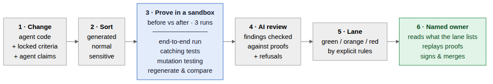

# The Change Passport

**How can a named human accept code written by an AI agent — without reading all of it — and still be accountable for it?**
*Tieto challenge "Earned Trust in AI Code" — Junction 2026*

---

## The idea in 30 seconds

Agents now write code faster than humans can read it. Reading every line no longer scales, and letting an AI approve removes accountability.

We propose a different object of review: the **Change Passport**. Every agent-written change travels with a passport that says **what was asked**, **what the agent claims it did**, **the proof for each claim** — obtained by *running* the code before and after the change, not by asking an AI's opinion — **what the AI refused to decide**, and **how much a human must read**. A **named owner** reads only what the risk requires, can **replay any proof with one command**, and **signs** what was checked and what was not.

> **The AI reviews. The proofs decide what is true. A human decides and stays accountable.**

## How it works

| Step | What happens | Why |
|---|---|---|
| **1 · Change** | The agent delivers code + the requirement ID. A human has locked 3–6 short **acceptance criteria**; the agent declares its **claims**. | Every check needs a reference for "correct" that does not come from the agent itself. |
| **2 · Sort** | A versioned policy sorts files: *generated*, *normal*, *sensitive* (public API, build, security). Each change is linked to a criterion; code linked to nothing is **orphan** and always shown. | Not all lines deserve the same attention; rules that anyone can read decide, not a black box. |
| **3 · Prove** | In a disposable **sandbox**, the change runs **before and after**, 3 times: **end-to-end** on the real product, **catching tests** generated from the criteria, **mutation testing** (do the tests even notice each change?), **regeneration** of generated files. | Reading shows what code *says*; running shows what it *does*. The agent's own tests are not independent evidence. |
| **4 · AI review** | A reviewer model (different from the author) lists findings, each quoting the code, then checked against the proofs. It **refuses** decisions that belong to people (public API, user-visible behaviour, compatibility, risk acceptance). | AI reviewers are useful but often wrong; an unproven finding is labelled "opinion". |
| **5 · Lane** | Explicit rules choose **green** (quick check), **orange** (read the listed parts) or **red** (send back or full read). The AI can raise the risk, never lower it. | Human attention goes where the risk is; every routing decision is explainable. |
| **6 · Owner signs** | The owner answers two questions *before* seeing the AI's view, reads what the lane lists, decides each refusal, replays any proof, and signs: **checked (by whom/what) · not checked (why) · risk accepted**. The owner merges. | A bounded signature makes accountability real without asking anyone to "have read everything". |

Trust is then **measured** (reverts, incidents, random counter-reviews, injected canary bugs) and **earned per code zone**: a zone with a clean track record gets lighter review; one escape suspends it.

## Why we designed it this way

1. **Review is now the bottleneck.** Teams adopting AI see review time ×5 and 31% more PRs merged with no review at all (Faros 2026). Tieto's own Agentic DevOps doubled delivery — and doubled the review load.
2. **Human review was already weaker than we assume.** At Vercel, over half of PRs were approved without a comment, 18% in under 5 minutes. A click is not a check.
3. **AI reviewers alone are not trustworthy.** The best reach 50–60% F1 on real PRs, are confidently wrong, and favour code from their own model family.
4. **An agent's tests prove what the agent believes, not what was asked.** 80% of agent-written tests have weak or no assertions. In our own run, an agent's change passed all 169 tests and still broke users' builds.
5. **Auto-approval solves speed, not accountability.** Meta, Vercel or Intercom auto-approve low-risk PRs, but none says who answers when an auto-approved change breaks.

So the design keeps three things separate: **the requirement** (human), **the evidence** (machine, independent of the agent) and **the decision** (named human).

## What it brings

| For | Benefit |
|---|---|
| **The owner** | Reads a fraction of the change (one 237-file agent change: 46 of 1,392 lines), with the most dangerous parts first; sees proofs, not opinions; can replay any of them. |
| **The team** | Agent speed is kept: review effort scales with risk, not with the size of the diff. |
| **The organisation** | Every merge has a named, bounded attestation — an audit trail aligned with human-oversight expectations (EU AI Act art. 14, ISO/IEC 42001), without claiming compliance. |
| **Quality** | Regressions that the agent's tests miss are caught by execution against the criteria. |

## Our edge

| | Line-by-line human review | AI review bots (CodeRabbit, Copilot review…) | Risk-routed auto-approval (Meta, Vercel…) | Tieto Agentic DevOps (today) | **Change Passport** |
|---|---|---|---|---|---|
| Scales with agent output | ✗ | ✓ | ✓ | ✗ — every MR fully approved by a human | ✓ — reading scales with risk |
| Evidence independent of the agent | ✗ | ✗ — opinions | partly — CI + LLM | ✗ — same CI as human code | ✓ — sandbox, before vs after |
| Says what was **not** checked | ✗ | ✗ | ✗ | ✗ | ✓ |
| AI refusals made visible | — | ✗ | ✗ | — | ✓ |
| Named human for **every** change | ✓ | ✓ | ✗ for auto-approved changes | ✓ | ✓ |
| Proofs replayable by the signer | ✗ | ✗ | ✗ | ✗ | ✓ one command |
| Trust measured and earned per zone | ✗ | ✗ | partly | ✗ | ✓ |

**In one sentence:** the others make review faster *or* safer; the passport changes **what is reviewed** — proofs instead of lines — so it can be both, while keeping a named human accountable for every change.

## What we demonstrated (reference implementation, public repository)

- On a 237-file agent change: all agent tests green, yet **two user-breaking regressions** found by execution against the criteria; the owner had **46 lines** to read; the AI reviewer found 4 of 5 issues and **refused 6 decisions**, all routed to a person.
- On two bug-fix changes, using only generic steps: the issue's own reproduction, run end to end, **crashes before and works after**; the owner reads 39 of 228 and 36 of 266 lines. On one of them the run also showed the issue's own description was inaccurate (the analyzer crashed rather than "did not work").
- **The whole chain runs live** on a change in a few minutes: sort → prove (base vs branch, 3 runs) → blind AI review → verification against the proofs → lane → passport. In the live run the AI raised a user-visible question nobody had settled, and the rules moved the change from orange to **red**: the AI can raise risk, never lower it.
- **In a real pull request**: the passport is posted on the PR, a `passport/owner-signature` status stays pending until the named owner signs, and the signature is bound to the commit; signing as someone else, on another commit, without answering every refusal, or accepting a red change without a full read is refused.
- 8 typical agent defects injected into our own pipeline: **8 flagged**.

This is an illustration on public data, not statistical proof — see [measurement](05-measurement.md) and [limits](06-limits-and-failure-modes.md).

## Principles

**1** Requirement first · **2** Evidence, not confidence · **3** Independence from the agent · **4** Rules decide the lane, the AI can only raise risk · **5** Review depth follows risk, a human signs every lane · **6** Refusing is a normal output · **7** Trust is earned per zone and withdrawn after an escape · **8** The review factory secures itself (PR content is untrusted, no AI has merge rights).

## Trade-offs and limits

- **Cost:** humans write short criteria; each repository needs evidence harnesses (end-to-end, test generation) once. On an existing project the passport is **additive**: it reuses the CI, tests, CODEOWNERS and branch protection already there ([how](09-adoption-on-an-existing-project.md)).
- **Friction:** a signature even in green (1–2 min); questions before the AI view in orange/red.
- **Lean to caution:** *a false orange costs a review; a false green costs an incident.*
- **Not judged:** architecture and product intent — they become refusals, i.e. human decisions.
- **Bounded by the criteria:** a wrong criterion gives a passport that is "proven" and still wrong.

## Read next

| | |
|---|---|
| [01 · Problem](01-problem.md) | The evidence behind the five reasons above |
| [02 · Workflow](02-workflow.md) | Roles, lanes, how it plugs into GitLab/Jenkins/Jira |
| [03 · Steps](03-steps/) | **Each step: what it does, why we chose it, alternatives rejected, sources, limits** |
| [04 · Principles & trade-offs](04-principles-and-tradeoffs.md) | How we balance risk, hallucination, transparency, confidence, quality |
| [05 · Measurement](05-measurement.md) | How trust is measured and earned |
| [06 · Limits & failure modes](06-limits-and-failure-modes.md) | What can go wrong — including what we removed because it was over-fitted |
| [07 · Decision log](07-decision-log.md) | Every decision with its reason and the rejected alternative |
| [08 · Sources](08-sources.md) | 2026 research behind the choices |
| [09 · Adoption on an existing project](09-adoption-on-an-existing-project.md) | How it plugs into a brownfield repository and pipeline: what it reuses, what it adds, cold start, rollout |
| [10 · Lessons log](10-lessons-log.md) | What we learned building and running it, including what surprised us |
