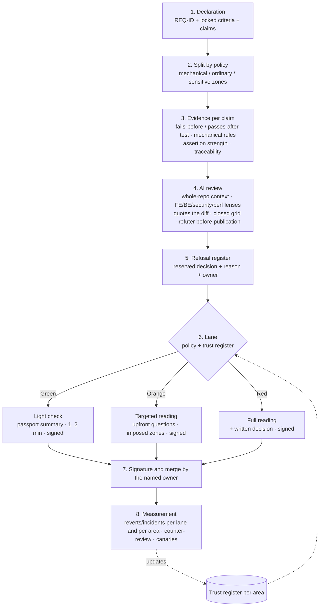

# Concept — The Change Passport

---

## Concept card (1 page)

**Recommendation.** In the "PR review factory", we no longer review code line by line: we check a **passport**. Every change written by an agent travels with what it claims to do (tied to a requirement ID), the evidence that backs it, what the AI found, what it **refused to decide and why**, and the review lane its risk imposes. **The AI advises with evidence, it never approves.** A named engineer signs every change; the depth of their review depends on risk, and their signature states what was checked, by whom or what, what was not, and the residual risk they accept.

**Principles**
1. **Requirement first** — nothing gets in without an ID and locked acceptance criteria.
2. **Evidence, not trust** — every claim carries typed evidence; the strongest is **end-to-end execution in a sandbox** against criteria signed beforehand; an AI opinion without evidence is labelled as such.
3. **Independence** — reviewer from a different model family; evidence derived from the criteria, not from the agent's tests.
4. **Rules you can explain decide the lane** — the LLM can raise the risk, never lower it.
5. **Depth follows risk** — green: light signed check; orange: targeted reading; red: full reading.
6. **Refusing is a normal outcome** — refusal register with reason and owner.
7. **Trust is earned per area and withdrawn after an incident** — trust register per code area.
8. **The review factory is itself a system to secure** — the content of a PR is untrusted input.

**Trade-offs** — writing criteria and policy takes time · a lot of orange at first · we prefer a needless review to an incident · friction (upfront questions) reserved for orange and red.

**Limits** — does not judge architecture or product intent (they end up as refusals) · a badly written criterion yields a "proven" but wrong passport · the demo on 4 branches illustrates, it does not prove statistically.

**What is not accepted** — "The AI said it was fine" · a merge without an owner · trust without evidence · a risk score nobody can explain.

---

## 1. The problem

- Agents produce more than humans can read: review time ×5, +31 % of PRs merged with no review at all (Faros 2026).
- Human review was already often a rubber stamp: at Vercel, >50 % of PRs approved without a comment, 18 % in under 5 minutes.
- AI reviewers alone plateau at 50–60 % F1 on real PRs (Martian Bench), almost nothing beyond 150 lines.
- 80 % of tests written by agents have weak or missing assertions.
- Companies that auto-approve (Meta, Vercel, Rewind…) have solved throughput, not accountability: who answers for an auto-approved change, what did the human check, does the change do what was asked — nobody says.

**Our thesis**: trust comes from **evidence a person can check and stand behind**, from **explainable risk-based routing**, and from **a signature that states what it covers** — not from the confidence an AI displays.

**Chosen direction**: an **evidence-based classifier** (it separates what deserves a human from what meets the standard), fed by **specialised reviewers** that together cover frontend, backend, security and performance.

---

## 2. Roles

| Role | Who | Responsibility |
|---|---|---|
| **Author agent** | The coding agent | Produces the change and declares its claims |
| **Verification factory** | Rules + tools + AI from another family | Splits, proves, reviews, refuses, routes. **Never approves, has no merge rights** |
| **Named owner** | The engineer designated for the affected area (CODEOWNERS) | Settles refusals, does the review the lane imposes, **signs the passport, merges, remains accountable for the production release** |
| **Policy guardian** | Tech lead / quality lead | Owns `review-policy.yaml` and the trust register; reviews the metrics every week; any change to the policy goes through a reviewed PR |

---

## 3. The journey of a change



### 1. Declaration
- **Requirement ID** and **acceptance criteria** written or validated by a human before the agent works, then **locked** (the agent cannot weaken them).
- **Claims** from the agent, one per line ("All generated code carries `[ExcludeFromCodeCoverage]`", "No runtime behaviour change").

### 2. Split by policy
`review-policy.yaml`, versioned, protected by CODEOWNERS, classifies each file and hunk **by rules**:
- **Mechanical**: generated files, snapshots, renames — checkable by a rule.
- **Ordinary**: everyday application code.
- **Sensitive**: public API, contracts, diagnostic identifiers, generator core, **security paths** (authentication, authorisation, secrets, crypto), **CI/build and agent instruction files** (`AGENTS.md`, `CLAUDE.md`), **new dependencies**.
- **Size cap** for non-mechanical zones (beyond it: splitting required).
- **The LLM can raise the risk level, never lower it.** The author's declared identity never lowers the risk.

### 3. Evidence per claim
Independent of the author agent:
| Type | Example | Checked by |
|---|---|---|
| **Executed** | Test derived from the criteria: fails on the base, passes with the change | Tool (isolated CI) |
| **Executed end to end (E2E) in a sandbox** | The change is actually run: user journey (frontend), API calls against a started service (backend), consumer project compiled and run (library) — with video, screenshots, traces, logs attached to each criterion | E2E agent in a disposable sandbox |
| **Mechanical** | "The 222 snapshots differ only by the addition of line X" | Rule |
| **Strength of the agent's tests** | Do the assertions check a result? Mutants on the modified lines | Tool |
| **Traceability** | Each hunk tied to a claim; orphan code = flag | Rule |
| **Deterministic checks** | Build, analysers, SAST, existence of added packages | Tool |
| **AI opinion** | Finding that quotes the diff without executable evidence | AI — labelled "opinion" |

#### End-to-end evidence in a sandbox
Reading a diff tells you what the code *says*. Running it tells you what it *does*. The factory runs the change in a **disposable sandbox** (frozen image, synthetic data, no secrets and no outbound network) and produces, **for each acceptance criterion**, a *passed / failed / not tested* verdict with its artefacts:

| Change type | What is executed | Artefacts in the passport |
|---|---|---|
| **Frontend** (web, mobile) | An agent drives the application like a user through the criteria's journeys | Timestamped video per criterion, before/after screenshots, console and network logs |
| **Backend** (API, service) | Service started with an ephemeral database; call scenarios derived from the criteria | Request/response traces, logs, replayable script |
| **Library / generator** (our case) | Real consumer project compiled and run, per target | Build output, assembly inspection, console output |

**What a green E2E lets you say**: *"each acceptance criterion covered by a signed scenario was observed working in a real environment"*. It is the strongest evidence in the passport: a criterion proven by E2E no longer needs to be read in the code. **What it does not let you say**: "the feature is well made" in the broad sense — it sees neither unwritten scenarios, nor other targets, nor effects on existing code. On 2297, the agent's 169 tests were green; it was the E2E built **from the signed criteria** (a real user project, two targets) that showed user code excluded and the feature missing on netstandard2.0.

Rules:
- **The oracle is signed before execution**: the owner validates the criteria and the (short) list of scenarios — not the code. Scenarios come from the criteria, never from the diff.
- **"Not tested" stays visible** and never counts as a success.
- **Every claim points to an artefact** (log line, video timestamp); without an artefact, it is "unproven".
- **Replayable**: image, data and script archived, artefact hash linked to the passport.
- We watch for **shortcuts by the E2E agent** (e.g. bypassing the UI with a script).

Inspired by what is published by OpenAI (Codex tasks in an isolated container, summaries that cite terminal and test logs; reviewer with code execution), **Minitap** (QA agent that drives iOS/Android/web apps on devices, *expected vs observed* report per criterion, synchronised video, signature export), Greptile TREX, Devin (test plan then annotated video), Cursor (agents in VMs that deliver video and screenshots). **Common limit**: when scenarios are derived by the same AI from the code, the evidence is not independent — hence the oracle signed beforehand.

#### Three mechanisms that make evidence verifiable
- **One-click replay**: every executed piece of evidence can be replayed on the base and on the branch, side by side; the owner can modify the scenario to explore; each replay is recorded in the attestation. An AI opinion without a replayable scenario remains an opinion.
- **Mutation testing limited to the diff**: each of the agent's changes is reverted one at a time; a change that no test notices moves the lane to orange. On 2297: the agent's tests notice only 3 changes out of 10.
- **Catching tests** (inspired by Meta JiTTests): disposable scenarios generated **from the criteria**, run on base and branch. *Passes before / fails after* = catch; *fails before / passes after* = implementation proven; *fails on both sides* = to be examined by a human (criterion not met or invalid test). The generator sees only the criteria and the list of touched files, so as not to inherit the agent's mistakes.

#### Safeguards on the evidence itself
- **Anti-flakiness**: each test runs 3 times on base and branch; a result that changes is "flaky" and never counts as evidence.
- **Assertion strength**: a test with no assertion, a trivial or tautological assertion, or that only checks text is flagged; if it comes from the agent, it goes into the reading contract.
- **Test ↔ criterion link**: each test cites the criterion it covers (AC-n). A criterion is only "supported" if a linked test passes on the branch; otherwise it stays "supported without a linked test" and the lane cannot be green.
- **Moved code**: an identical block deleted elsewhere in the same diff is excluded from reading, with the evidence shown.
- **Reading contract sorted by risk**, with the list of what does not need reading and why.

### 4. AI review
- **Whole-repository context**, not just the diff.
- **Specialised lenses**: backend (logic, contracts), frontend (visible behaviour, accessibility) when relevant, **security**, performance, tests. Each lens switches off if the diff does not concern it.
- Model from a **different family** than the author agent.
- **Quotes the diff before concluding** (quotes → reasoning → verdict).
- **Closed grid per hunk**: safe categories or risk signals; a single signal = escalation.
- **Verification before publication**: a refuter tries to demolish each finding; only those that survive are shown.
- **Deterministic verdict engine** (tested code): the LLM supplies elements, the rule decides the lane.
- No style or naming remarks.

### 5. Refusal register
The AI never decides, even when confident:
- shape and naming of a **public API**;
- **visible behaviour change** (product intent);
- **compatibility, versioning**, assignment of identifiers;
- **architecture trade-offs**, cross-component effects;
- **acceptance of a security risk**;
- any claim **with no available evidence**.

Each refusal is recorded with its **reason** and the **owner** who must decide.

### 6. Three lanes — the human always signs

| Lane | When | Human review | Target duration |
|---|---|---|---|
| **Green** | Mechanical/ordinary zones of a **trusted** area, all claims proven, no refusal | **Light check**: the owner reads the passport summary (proven / unproven / residual risk) and signs | 1–2 min |
| **Orange** | Sensitive zone touched, unproven claim, minor refusal, or area not yet trusted | Upfront questions → **reading of the imposed zones** → refusals settled → signature | 10–30 min |
| **Red** | Major refusal (public API, behaviour, security), contradicted evidence, large change that cannot be split | **Full reading** + written decision → signature | depends on size |

All lanes: **the owner is the one who merges**. The AI never grants the approval.

### 7. Signature
1. **Upfront questions, before seeing the AI's opinion** (orange and red lanes): "Does the criterion reflect the issue?", "Which behaviour must remain unchanged?".
2. Review imposed by the lane, refusals settled.
3. **Signed attestation**:

```
Change       : ju26-issue-2297            Requirement : #2297       Lane : Orange
Owner        : <name>, src/MessagePack.SourceGenerator

VERIFIED                                        BY
  222 snapshots = mechanical attribute addition  rule snapshot-only-attribute
  Build + test suite                             isolated CI
  Criterion test #2297: fails before, passes after tool (test derived from criterion)
  Generator hunks: 0 risk signals                AI reviewer (family B) + refuter
  Generator/Templates/*.cs (3 files)             me (reading)

NOT VERIFIED                                    WHY
  Impact on third-party coverage tools           outside the repo, no environment
  Behaviour on real user projects                no corpus of projects

DECISIONS (refusals settled)
  Attribute on user partial types                accepted / refused — reason

RESIDUAL RISK ACCEPTED
  Third-party coverage tools might ignore the attribute; impact limited to reporting.

Signed: <name>, <date>    Passport hash: <hash>
```

The signature does not say "I reviewed everything". It says **what was checked and by whom or what, what was not and why, and the risk I accept**.

### 8. Trust register per area
- Each area (folder, module) has a **trust level**: *new*, *trusted*, *suspended*.
- **Earn**: N signed changes over 60 days with no revert or incident, agreement ≥ 90 % in counter-review → the area becomes *trusted* and can go into the green lane.
- **Lose**: an incident or revert linked to a passport in the area → area *suspended* (no more green lane), analysis of what the chain missed, new rule or new test added, then requalification.
- Same logic for **agent task types** (inspired by Meta's runbooks).

---

## 4. Technical considerations

### Frontend — the passport page
- **Header**: requirement, lane, owner, estimated review time.
- **Upfront questions** displayed **before** the AI verdict (orange/red).
- **Claims** with status: proven (evidence type) / unproven / contradicted.
- **Reading contract**: list of zones to read, with tracking of what has been opened; the rest is collapsed and marked "proven by …".
- **AI findings** with diff quote and evidence; **"Incorrect?"** button on each.
- **Refusals** to settle, with reason.
- Pre-filled **attestation form** (verified / not verified / residual risk) → **Sign** button.
- No persuasive explanation or opaque score: evidence and statuses.

### Backend — the verification factory
- **E2E sandbox**: disposable environment per passport (container/VM, frozen image, synthetic data, no secrets or outbound network); for a frontend, a browser or emulator driven by an agent; for a backend, service + ephemeral database; artefacts versioned and linked to the passport.
- **Trigger**: GitHub App / CI job when the PR is opened (not on untrusted public comments).
- **Stages**: split (YAML policy) → evidence (isolated build/tests, mechanical rules, mutants, traceability) → AI reviewers (lenses + refuter) → verdict engine → passport (JSON).
- **GitHub outputs**: a "Passport" check (never an approval), a summary comment, a link to the passport page.
- **Branch protection**: merge impossible without the **named owner's signature** (CODEOWNERS approval + "signed attestation" check).
- **Storage**: passport + signed attestation versioned, linked to the SHA (in-toto-style attestation format) → audit trail.
- **Metrics**: each revert/incident automatically linked to the originating passport; trust register updated.

### Security — two angles
**a. Security within the review**
- Security lens in the panel; security paths, CI/build, agent instruction files and new dependencies = **sensitive zone** (orange minimum).
- Deterministic checks: SAST, verification that added packages exist and are known.
- **Accepting a security risk = systematic refusal**: always decided by a human.

**b. Security of the factory itself** (the AI reviewer is a target: 2026 incidents of CI secrets exfiltrated via PR titles, of reviewers fooled by a forged Git identity)
- **PR content is untrusted input**: titles, descriptions, comments, images, rule files.
- Reviewer **read-only**, **without secrets**, **without outbound network access**, build and tests in a disposable **sandbox**.
- **Never runs a configuration supplied by the PR** (linters, scripts) outside the sandbox.
- **No approval or merge rights**: even a manipulated reviewer can only produce a passport, which a human reads.
- The author's declared identity **never lowers** the risk; any change to `AGENTS.md`/`CLAUDE.md`/CI is flagged.

---

## 5. Measuring trust

**Progressive rollout**: replay on history → silent mode → visible passport → green lane opened area by area, **only if agreement ≥ 90 %** with humans.

| Jury question | Indicator |
|---|---|
| Do reverts and incidents go up when review time goes down? | Reverts/incidents **per lane and per area** vs baseline period; review time per lane |
| Are AI findings real and accepted? | % confirmed ("Incorrect?"), % followed by a change |
| What does the AI miss? | **Counter-review**: 10 % of green lanes drawn at random and fully reviewed; injected **canary bugs**: % detected |
| Time to merge? | p50/p75 per lane, **timed** signature time |
| Share routed to humans? | Green/orange/red distribution; lines to read / lines in the diff |

**Circuit breakers** set in advance: area suspended if a revert/incident is linked to it; green lane suspended globally if green reverts > 3× the baseline, counter-review agreement < 90 %, or a canary goes green.

---

## 6. Scaling

- **AI cost bounded by risk**: depth of the lenses according to the lane (industry benchmark: ~$0.2 trivial to ~$1.7 full per review).
- **Human time goes down without disappearing**: the green lane costs 1–2 minutes, attention concentrates on orange and red (at Vercel, load per reviewer went from 13 to ~5 PRs/week and issues flagged on risky PRs were multiplied by 4).
- **Policy is configured per team and per area**, not globally.
- **The trust register** avoids re-reading everything everywhere: trust earned on one area is not transferred to another.
- **Random counter-review** stays at 10 % of greens whatever the volume: that is the statistical guarantee.

---

## 7. What would make us doubt our own result

- A **canary** that goes through the green lane.
- A **revert or incident** linked to a green passport.
- **Counter-review agreement dropping** below 90 %.
- **Claims "proven" by tests with weak assertions**.
- A **refuter and a reviewer unanimous** on a false finding (false consensus).
- **Signatures too fast** for the lane (orange signature time < reading time of the imposed zones).
- **Few refusals**: an AI that never refuses anything is suspect.

---

## 8. Trade-offs and limits

| We gain | We pay |
|---|---|
| The human reads what matters | Writing and maintaining criteria and policy |
| Evidence rather than opinions | Not all claims are provable → a lot of orange at first |
| Leaning towards the human when in doubt | Needless reviews (a false orange costs a review, a false green costs an incident) |
| Signature even in the green lane | 1–2 minutes per change, always |
| Upfront questions against over-trust | Friction, reserved for orange and red |
| Clear accountability | The owner must accept signing a bounded attestation |

**Limits**: architecture and product intent remain human · depends on the quality of the criteria · industry-published gains are self-reported and biased · demo on 4 branches = illustration, not statistical proof · out of scope: finished product, model training, tool choice.

---

## 9. Real illustration on `ju26-issue-2297` (executed — see `factory/`, `measurements.md`)

| Step | Result |
|---|---|
| Declaration | REQ-2297, 4 locked criteria, 4 claims from the agent (C1–C4) |
| Split | 222 snapshots (mechanical), 7 `.tt` + TransformUtilities (sensitive), 6 T4 `.cs` (derived), 1 test, README |
| Evidence | Mechanical rule: 220 compliant, 2 flagged (same cause) · coverage: all annotated types · 169/169 tests · agent's tests fail before / pass after · **2 independent acceptance tests: CS0579 regression and user code excluded** · **the attribute exists in netstandard2.0 and net472** |
| AI review | 4 findings, **4 confirmed**; 1 severity underestimated; **1 issue missed** (wrongly asserted "fine") |
| Refusals | R1 user code excluded (major) · R2 netstandard/.NET Framework scope · R3 on/off setting · R4 unproven docs |
| Lane | **Red**: AC-2 and AC-3 contradicted by evidence → "do not sign as is" |
| Reading contract | **10 files / 56 lines out of 237 / 1,392** |
| Owner's decision | Sent back to the agent with E3, E4, E5 and 4 written decisions (`factory/out/attestation-REQ-2297.json`) |

**237 files · 220 proven by a rule · 56 lines read by a named human · 4 decisions no AI made · 2 regressions the agent's tests did not see.**
