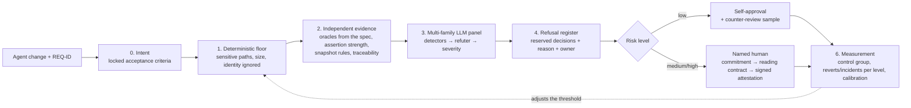

# AI code review of AI-written code — 2026 state of the art and what we take from it

> Research of 14 Nov 2026 — 8 sub-agents, **2026 sources only** (~110 items, deduplicated and cross-checked).
> Confidence: **V** = verified (2+ sources or primary source read) · **P** = plausible (1 source) · **I** = uncertain.
> ⚠️ Vendor figures (Faros, Qodo, Greptile, Tessl, Intercom, Rewind…) = self-reported. Vercel pages returned 404 at verification time.
> **Scope: cybersecurity is deliberately excluded.** Details of the self-approval systems: see `self-approval-2026.md`.
> Foundations predating 2026 (human factors in particular) are kept only in **§7 Foundations**, when a 2026 source confirms them.

---

## 1. Summary — what to remember

1. **Verification has become the bottleneck, and it is giving way.** Faros 2026 telemetry (22k devs): tasks +34 %, but **review time ×5, incidents/PR +243 %, +31 % of PRs merged with no review at all** (V, vendor). Google (3.5 M C++ changes): AI code from 29 % → 69 %, **1.9× more blocking review threads** (V). GitClear: duplication +81 %, refactoring −70 % since 2023 (V). No DORA 2026 report (P).
2. **AI reviewers remain weak on real PRs**: 15–31 % of human-found issues detected (SWE-PRBench, V), F1 0.85 on synthetic → **0.07 on real PRs**, and near zero beyond 150 lines of diff (V). Market ceiling: **50–60 % F1** (Martian Bench, 17 tools, V). The claimed "no. 1s" contradict each other.
3. **"Green tests" prove nothing**: **80 % of tests written by agents have a weak or missing oracle** (86k patches, V); ~20 % of "resolved" patches in the top 30 are wrong (SWE-ABS, V).
4. **A model must not judge itself**: family bias of +3 to 8 points, presentation order flips the verdict 55 % of the time (V); a model corrects an error presented as *external* +23 to 93 points better than its own (V). Cross-model adversarial verification filters out ~80 % of false findings — but **false consensus** is a documented failure mode (V).
5. **The real human problem is no longer narrowing attention, it is the absence of review**: most agent PRs are reviewed by no human, and when they are reviewed it is by agents (V). Complex code + AI label → **over-acceptance of wrong revisions** (385 reviewers, FSE 2026, P). Explanations increase confidence, not correctness (P). Under time pressure, delegation +43 % (P).
6. **Industry decided in 2026: self-approval, but only routed by risk.** Meta RADAR (331k diffs auto-landed, reverts ÷3, incidents ÷50), Intercom (19 %, revert 0.53 % vs 5.39 % human), Vercel (58 %), Rewind (~40 %, 99 % human agreement), Tessl (75 %), Cloudflare (131k reviews/30 d). Thoughtworks Radar puts **"risk-tiered human oversight" in Trial** and denounces *human-in-the-loop theater*. Always with: **sensitive paths excluded by deterministic rule**, size cap, **merge or accountability remaining human**. ⚠️ selection bias everywhere.
7. **Counter-current worth knowing**: StrongDM ("code must not be reviewed by humans") and OpenAI harness engineering (human review *after* merge, by sampling) vs **HumanLayer, which had to rewrite its system after 6 months without reading the code**.
8. **The startup market produces pieces, nobody produces the signable object**: AI opinions, execution evidence, formal proofs, provenance, triage, canary… but no **per-PR attestation dossier** that says what was proven, how, what was **not**, and what the named human checked. **That is our spot.**

---

## 2. What 2026 research shows

| Result | Source | Conf. |
|---|---|---|
| SWE-PRBench: 8 frontier models detect **15–31 %** of the issues flagged by humans; more context ≠ better (diff + summary > full context) | arXiv 2603.26130 (March 2026) | V |
| c-CRAB: even combined, PR-agent, Devin, Claude Code, Codex resolve ~40 % of tasks | arXiv 2603.23448 | V |
| OpenCodeReview: **mostly deterministic pipeline** SEM-F1 25.1 % vs 11.6 % for general-purpose agents, 5–15× fewer tokens | arXiv 2608.09290 | V |
| "Bigger isn't better": F1 0.847 synthetic → **0.066 real**; 0.657 (<10 lines) → **0.043 (>150 lines)**; Haiku 4.5 ≥ Sonnet 4.6 | arXiv 2606.15689 | V |
| SecPRBench (265 real vulnerabilities): recall 32–78 %; **68 % of misses: right file, wrong mechanism** | arXiv 2610.33509 | V |
| SWE-ABS: 19.7 % of "passing" patches rejected after strengthening the tests; the leader drops from 78.8 % to 62.2 % | arXiv 2603.00520 | V |
| **All Smoke, No Alarm**: 80.2 % of agent tests with weak/missing oracle; strong oracles from 18 % (Codex) to 67 % (Claude Code) | arXiv 2606.18168 | V |
| Family bias: a judge favours its own family by +3.4 to 8.4 pts; AB/BA order flips **55.4 %** of verdicts | arXiv 2609.17857 | V |
| Self-preference: capability does not reduce the bias; structured multi-dimension evaluation −31.5 % | arXiv 2604.22891 | V |
| SE judges sensitive to prompt wording on identical code | arXiv 2604.16790 | V |
| **Self-Correction Illusion**: presenting the error as external → +23 to 93 pts of correction (maths/logic) | arXiv 2606.05976 | V |
| **Refute-or-Promote**: refuter agents + critique from another model eliminate ~80 % of 171 findings; 4 CVEs; **false consensus** in 3 cases | arXiv 2604.19049 | V |
| Adversarial Review: coder/reviewer/critic trio in structured disagreement > team of 5, after correcting false consensus | arXiv 2608.18167 | V |
| Fine-grained calibration (per segment) + Platt scaling < global calibration error; **no evidence of good native calibration** | arXiv 2604.06723 | V |
| **PatchGuru**: executable oracles derived from the PR *description*; 12 unknown bugs on 400 PRs, precision 0.62, **$0.07/PR** | arXiv 2602.05270 | P |
| **Assurance Boundaries**: a verifier can be right about its property while the acceptance decision remains wrong for the task | NeurIPS 2026 WS | P |
| Vero: repository-scale formal proofs, 27/43; **"specification drift"** (the agent weakens the spec) | arXiv 2608.13522 | V |
| PBT-Bench: agent recall 42–83 % on injected semantic bugs | arXiv 2605.15229 | P |
| R2Code: LLM requirement→code traceability +7.4 F1 | arXiv 2604.22432 | P |
| Mary Shaw: trust in AI code is probabilistic; the human brings **hidden context and fitness for use** | arXiv 2607.04667 | P |
| AIDev: 46.4 % of agent fixes rejected (wrong implementation, CI, incomplete, low priority) | arXiv 2606.13468 | V |

## 3. Human factors 2026

| Result | Source | Conf. |
|---|---|---|
| Most AI PRs **receive no review**; otherwise review by agents, the human drives the agent → review metrics do not prove oversight | Duma et al., EASE 2026, arXiv 2605.02273 | V |
| 385 reviewers: complexity ↑ → acceptance of wrong revisions ↑; **complex + AI label → over-acceptance** | Singh, Bacchelli et al., FSE 2026 | P |
| LLM assertions: 74 % correctness on correct ones, **49 % on incorrect ones**, identical confidence; bad explanations → correctness ↓ confidence ↑ | arXiv 2607.08885 | P |
| Detailed explanations → max confidence, not max agreement; moderate explanations → 89 % agreement | arXiv 2607.24601 | P |
| Under time pressure, **delegation +43 %**, invisible to usage metrics | arXiv 2605.29392 | P |
| Agents in review (1.02 M PRs): faster decisions, **unchanged quality** | arXiv 2607.13196 | P |
| Humans have 11.8 % more discussion turns on AI code; > half of rejected agent suggestions were wrong | arXiv 2603.15911 | P |
| Anthropic RCT: **−17 % comprehension** with AI (worse in debugging); engaged usage preserves learning | arXiv 2601.20245 | V |
| Agentic: "I'm not reading all of that" — no mechanism pushes people to review; recommendation: **cognitive forcing** | CHI 2026 WS, arXiv 2603.14225 | P |
| Terms of service of 9 tools: accountability is systematically shifted onto the user | Treude, AIware 2026 | P |
| Sonar: 96 % do not trust, **48 % always verify** ("verification debt"); Stack Overflow 2026: 7 % trust it for important decisions, 48 % only if they can verify | Sonar Jan. 2026; SO Oct. 2026 | V |
| AI Act: human oversight (art. 14) **pushed back to Dec. 2027** by the AI Omnibus; not directly applicable to a review tool | Deloitte June 2026 | V |

## 4. Industry 2026: risk-routed self-approval

| Actor | Mechanism | Result | Human | Conf. |
|---|---|---|---|---|
| **Meta RADAR** | Author/source classif. → eligibility → heuristics → Diff Risk Score → LLM (≥8/10) → deterministic validation | 535k reviewed, **331k auto-landed**, reverts ÷3, incidents ÷50, tunable threshold (60 % approval at the 50th pct) | High risk | V |
| **Intercom** | Sub-agents (statement, diff consistency, safety, logic); refuses large PRs | 19 % without a human; revert **0.53 % vs 5.39 %** | Shipping engineer monitors prod + rollback | P |
| **Vercel** | LOW/HIGH; ≥100 files = HIGH; CODEOWNERS = human | 58 % without a human, merge 29 h → 10.9 h; **control group** 0.39 % revert | CODEOWNERS | P (404) |
| **Rewind** | ~12 agents; hard rules: auth, secrets, crypto, multi-tenant, IaC; >10k lines refused | ~40 % auto, **99 % agreement** in counter-review, 0 incidents | **Human merge** | P |
| **Ona** | Listed criteria (<1000 lines, no infra/migration/auth/audit) | 1st approval 2h49 → 3.8 min | **Human merge (SOC 2)** | P |
| **Tessl** | Reviewer tuned to its standards | 75 % without a human; 91 % correct findings vs 68 % for the previous tool | Privacy/access = human | P |
| **Cloudflare** | ≤7 specialised reviewers + coordinator; 3 levels trivial/lite/full; *break glass* 0.6 % | 131k reviews/30 d, median 3 min 39, $1.19 | Can block | V |
| **Anthropic** Code Review | Multi-agent → verification → severity | 16 % → 54 % of PRs with substantive comments; <1 % wrong | **"still a human call"** | V |
| **GitHub Copilot** | Agentic, auto-resolution, can run build/tests | Serious findings fixed +47 % | Does not count as approval | V/P |
| **Atlassian RovoDev** | Generation + quality control | 38.7 % of comments → change (vs 44.5 % human) | No self-approval | V |
| **Thoughtworks Radar** vol. 35 | **"Risk-tiered human oversight" — Trial** | — | High risk/irreversible: human applies; medium: review; low: auto | P |

**2026 practitioners** — HumanLayer: 6 months without reading the code → rewrite; new flow = design ~200 lines + plan ~2 pages + **final code reviewed** (V). StrongDM "Software Factory": neither written nor reviewed by humans — Stanford Law: *"Trusted by whom?"* (V). OpenAI harness engineering: 1 M lines, human review **post-merge by sampling** (P). Orbital: proof of working mandatory (browser journey before/after), **"Merge stays human, every time"** (P). Linux 7.0: agents forbidden from Signed-off-by; *Assisted-by* tag abandoned in Oct. 2026 — Torvalds: *"I expect people to understand what they are doing"* (V). CPython: **forbidden to modify tests to make them pass** (P). Godot, Ghostty *Vouch*: contributor filtering (V). Linux Foundation: 25 % of incoming PRs judged "slop" (V). Tian Pan: **"rubber-stamp collapse"** — the bigger the diff, the more automatic the approval (P).

## 5. Startups 2026: angles of attack

| Family | 2026 actors | Trust comes from… | Strength | Blind spot |
|---|---|---|---|---|
| **A. Independent AI reviewer** | CodeRabbit (Series C $143 M, "Agentic Change Management", Triage, Change Stack), Qodo ($70 M, "the generator must not decide"), Greptile v5, Cursor Bugbot + Graphite, StarSling (YC, BYO-model in CI) | A second model + context + team rules | Integrated in the flow, scales | **50–60 % F1**; measures "acted on" not "correct"; opinion, not evidence |
| **B. Evidence by execution** | Greptile **TREX** (app in sandbox + video), Devin (test plan, VM, annotated videos), Canary (YC W26, E2E), Bugbot Autofix in VM, Antithesis (deterministic simulation) | Observed behaviour, readable artefacts | Concrete evidence in minutes | **Oracle problem**: tests derived from the same code/intent; partial coverage |
| **C. Formal verification** | Axiom ($200 M, code + Lean proof), Theorem × Anthropic (fuzz tests → specs, Rocq proofs; 239 entry points) | Deterministic verifier | Absolute guarantee on the property | Narrow spec, restricted scope, cost; "verified ≠ bug-free" |
| **D. Intent / standards upstream** | Tessl (skills, loops, verifiers; 80 % of PRs with no human edit), Qodo organisation rules | Compliance with rules written by humans | Control before generation | Checks rules, not business semantics |
| **E. Comprehension and triage** | Devin Review (reorganised diff, "Lazy LGTM"), CodeRabbit Change Stack, Qodo PR Triage, Greptile Review Tiers, stacked PRs | Human attention directed to what matters | Tackles rubber-stamping | **No record of what the human actually checked** |
| **F. Provenance** | Entire (ex-GitHub CEO, $60 M seed: *Checkpoints* = prompts/reasoning linked to the SHA), SCW Trust Agent | Traceability of the "why" | Audit substrate, changes who buys (CISO, legal) | **Recording ≠ verifying**; lock-in, confidentiality |
| **G. Evidence in production** | Hud (per-function canary, auto rollback, pre-merge impact map) | Real behaviour vs baseline | Safety net independent of reading | Detection after exposure; unsuited to the irreversible |

**Public referee: Martian Code Review Bench** (17 tools, 200k+ PRs; a comment counts if it leads to a change) → best tools 50–60 % F1; precision (Baz, Greptile) vs recall (Qodo) trade-off (V for the order of magnitude, I for the rankings). Futurum: **43 %** of organisations require human review of AI code in prod, **12 %** evaluate before promotion (P).

**Open positioning**: a neutral layer that **consumes** A–G and produces the **signable object** — one attestation dossier per change, and a **reading contract** per risk level.

---

## 6. Foundations predating 2026, kept because confirmed in 2026

| Foundation | 2026 status |
|---|---|
| Automation bias: errors of omission/commission (Skitka 1999; Parasuraman & Manzey 2010) | **Confirmed**: over-acceptance complex + AI (FSE 2026), delegation under pressure (2026) |
| Ironies of automation — loss of skill (Bainbridge 1983) | **Confirmed**: −17 % comprehension (Anthropic RCT 2026) |
| Moral crumple zone (Elish 2019) | **Confirmed**: terms of service shift accountability onto the user (Treude 2026) |
| Explanations → blind acceptance (Bansal 2021) | **Confirmed and nuanced** (Kaufman 2026; Gao 2026) |
| Cognitive forcing (Buçinca 2021) | **Not retested in code review**, need confirmed (CHI 2026 WS) |
| Self-preference (Panickssery 2024) | **Confirmed and extended** to the family level (2026) |
| Ineffective self-correction (Huang 2023) | **Confirmed, cause nuanced**: internal vs external framing (2026) |
| ~19 % F1 SWR-Bench (2025) | **Confirmed**; published FSE 2026 |
| 8–31 % wrong SWE-bench patches (2024-25) | **Confirmed, upper end of range** (~20 %, SWE-ABS) |
| DORA 2024-25: AI → instability | **Confirmed in direction** (Faros 2026), no new DORA; **nuanced**: with risk routing, lower reverts |
| METR 2025: −19 % | **No longer cite alone**: 2026 = −18 % to −4 %, CI including a gain, judged unreliable by METR |
| GitClear 2025 | **Worsened** (duplication +81 %) |

---

## 7. What we take from it for our concept

### 7.1 Recommendation (proposal)

> **Stop reviewing code: sign an attestation on evidence.** Every agent change arrives tied to a requirement ID. A chain **independent of the author agent** routes the change by **deterministically computed risk level** and applies a **reading contract** specific to that level. It produces an **attestation dossier**: each claim → the evidence that supports it (and its type: executed, formal, verified AI opinion) → **what was not verified** → **what the AI refused to decide and why**. A **named human** first commits on the intent, reads what the reading contract imposes on them, and **signs a bounded attestation** (in-toto). The AI never approves a risky change on its own; low risk can be self-approved **under human sample-based control and a control group**.

This is the synthesis of three findings: RADAR/Intercom show that risk routing holds at scale; HumanLayer shows that you cannot give up reading risky code; the market (families A–G) does not produce the object the human signs.

### 7.2 Principles (each backed by a 2026 source)

| # | Principle | 2026 anchor |
|---|---|---|
| P1 | **Requirement first**: every change is tied to an ID; orphan code = flag | R2Code; Assurance Boundaries |
| P2 | **Evidence, not opinion**: a finding without executable evidence is labelled opinion and does not block on its own; we measure **oracle strength**, not the presence of tests | All Smoke No Alarm; SWE-ABS; PatchGuru |
| P3 | **Independence**: reviewer from another family, panel with reversed order, refuting critic; oracles derived from the spec/description, not from the agent's tests | Family bias; Self-Correction Illusion; Refute-or-Promote |
| P4 | **Deterministic first**: path rules, caps, build, tests before any LLM | OpenCodeReview; RADAR; Rewind; Vercel |
| P5 | **Risk routes, not the AI**: deterministic floor (public API, migrations, CI/build, contracts, CODEOWNERS paths) that the LLM can only **raise**; size cap (~150 useful lines) | RADAR; Thoughtworks; "Bigger isn't better" |
| P6 | **Abstention is a first-class outcome**: refusal register with reason and named owner (architecture, concurrency, product intent, irreversible) | Cloudflare/Intercom (acknowledged limits); Shaw |
| P7 | **Transparency on coverage**: the "not verified" list is mandatory; an empty AI review is not a green light | Martian 50–60 %; Tian Pan rubber-stamp |
| P8 | **The human commits before seeing the AI and signs what they checked** — no advocacy, evidence | FSE 2026 over-acceptance; Kaufman; CHI 2026 WS; Linux 7.0 |
| P9 | **Trust is measured**: control group, sample-based counter-review, injected bugs, per-segment calibration | Vercel; Rewind; Qodo/Martian; arXiv 2604.06723 |

### 7.3 Reference pipeline

### 7.4 Failure modes (and countermeasure)

| Mode | 2026 evidence | Countermeasure |
|---|---|---|
| **No review at all** (agent PRs not reviewed) | Duma EASE 2026; Faros +31 % without review | Routing makes non-review **explicit and bounded** to low risk, with sampling |
| Rubber-stamp collapse / over-acceptance of complex code | Tian Pan; FSE 2026 | Size cap; complexity ↑ ⇒ risk level ↑; upfront commitment |
| Tautological green tests, CI gaming | All Smoke; CPython | Oracle strength measurement; test/snapshot diff = always flagged |
| False consensus of the AI panel | Refute-or-Promote; Adversarial Review | Refuter from another family; unanimity ≠ evidence |
| Judge bias (family, order, prompt) | 2609.17857; 2604.16790 | Heterogeneous panel, reversed order, structured evaluation |
| Specification drift (the agent weakens the spec) | Vero | Spec/criteria signed and locked out of the agent's reach |
| "Verified" but wrong for the task | Assurance Boundaries | The human signs the obligation → property link |
| Delegation under pressure, loss of skill | 2605.29392; Anthropic RCT | Measure the time actually spent; rotation; comprehension questions |
| Moral crumple zone | Treude 2026 | **Bounded** attestation: what was seen, what was not |
| Selection bias in the metrics | RADAR, Intercom | Mandatory **control group** |

### 7.5 Measurement plan (hackathon → production)

1. **Recall/precision via injected bugs** on the 4 MessagePack branches (Qodo/Martian style) — incl. corrupted snapshots, `catch` that swallows, attribute on `partial`.
2. **Oracle strength** of the tests written by the agent ("All Smoke" method) and SWE-ABS-style **strengthening**: how many patches survive?
3. **Calibration** of the risk score per segment (Brier/reliability) on this set.
4. **Reading contract**: lines the human must read / lines in the diff (e.g. 2297: 237 files → ?), **timed**.
5. **Production (projected, to be stated honestly)**: reverts and incidents **per risk level**, **control group** of low-risk PRs reviewed by humans (Vercel), sample-based counter-review (Rewind), time to merge p50/p75, share routed to the human, rate of findings acted on (benchmark: 36–39 % AI vs 44 % human), verification debt (PRs without review, churn, duplication).

---

## 8. Limits and blind spots

- **Many 2026 industry figures are self-reported and single-source** (Intercom, Rewind, Ona, Tessl, Vercel in 404, Greptile, Qodo): to be presented as "reported by", never as established fact.
- **Selection bias** in all self-approval results (RADAR included): the drop in reverts is partly due to the choice of diffs.
- **Unresolved contradiction** on robustness to misleading comments (Thornton vs Cloudflare/ALIBI).
- **Not found in 2026**: controlled replication of Tufano/Buçinca in code review; internal Google data on review; LinearB/Jellyfish; ANSSI guide dedicated to coding agents; Factory's verification mechanism.
- **Several papers are preprints** (arXiv) not yet peer-reviewed.
- Out of scope: detailed cost per risk level, legal aspects beyond the AI Act/DCO, .NET/source generator specifics (to dig into on the repo).

---

## 9. Sources (2026)

**Research** — arXiv 2603.26130 · 2603.23448 · 2608.09290 · 2606.15689 · 2610.33509 · 2603.00520 · 2604.01518 · 2606.18168 · 2604.22891 · 2609.17857 · 2604.16790 · 2606.05976 · 2604.19049 · 2608.18167 · 2604.06723 · 2605.02273 · 2606.13468 · 2602.09185 (AIDev) · 2602.05270 (PatchGuru) · 2601.15074 · 2605.15229 · 2608.13522 (Vero) · 2602.09464 · 2604.22432 · 2604.20577 · 2607.04667 (Shaw) · neurips.cc/virtual/2026/171473 · SWR-Bench FSE 2026 (DOI 10.1145/3808144)

**Human factors** — FSE 2026 (DOI 10.1145/3808165) · arXiv 2607.08885 · 2607.24601 · 2601.20245 + anthropic.com/research/AI-assistance-coding-skills · 2603.14225 · 2605.29392 · 2607.13196 · 2603.15911 · 2605.23130 · 2609.24234 · 2605.04532 · theregister.com 2026/01/09 (Sonar) · stackoverflow.blog 2026/10/06 · Deloitte AI Omnibus (June 2026)

**Industry & practitioners** — arxiv.org/abs/2605.30208 (Meta RADAR) · intercom.com/blog/ai-is-approving-our-pull-requests-heres-how-we-made-it-safe · vercel.com/blog/58-percent-of-prs-in-our-largest-monorepo-merge-without-human-review · rewind.com/blog/ai-approve-pull-requests-safely · ona.com/stories/auto-approving-low-risk-prs · tessl.io/blog/75-of-tessls-prs-now-merge-without-human-review · blog.cloudflare.com/ai-code-review · claude.com/blog/code-review · github.blog/changelog 2026-03-05 & 2026-09-11 · alignment.openai.com/auto-review · arXiv 2601.01129 (RovoDev) · thoughtworks.com/radar/techniques/risk-tiered-human-oversight · zenml.io (HumanLayer CRISPY) · ai.engineer (Horthy, Harness engineering is not enough) · factory.strongdm.ai · simonwillison.net/2026/Feb/7/software-factory · law.stanford.edu/2026/02/08 · latent.space/p/harness-eng · orbital.tech 2026-07-22 · theregister.com 2026/10/14 (Linux Assisted-by) · godotengine.org contribution-policy-2026 · discuss.python.org (CPython AI guidelines) · itsfoss.com (Vouch) · linuxfoundation.org (25 % AI slop) · tianpan.co 2026/04/23

**Measurement** — faros.ai/research/ai-acceleration-whiplash · gitclear.com/the_ai_code_quality_maintainability_gap · huggingface.co/papers/2608.06640 (Google C++) · metr.org/blog/2026-02-24-uplift-update · infoq.com/news/2026/05/dora-roi-ai-assisted-dev-report · waydev.co/dora-pauses-the-annual-survey · qodo.ai/blog/how-we-built-a-real-world-benchmark-for-ai-code-review · arXiv 2607.03316 (CodeRabbit in the wild) · sonarsource.com AI code verification debt

**Startups** — coderabbit.ai/blog/introducing-agentic-change-management · techcrunch.com 2026/03/30 (Qodo) · qodo.ai/blog/introducing-qodo-3.0 · greptile.com/changelog · cursor.com/blog/bugbot-autofix · cognition.com/blog/devin-review · cognition.com/blog/testing-development · dealroom.co (StarSling) · Launch HN Canary YC W26 · fortune.com 2026/03/23 (Antithesis) · siliconangle.com 2026/03/12 (Axiom) · anthropic.com/research/formal-verification (Theorem) · sdtimes.com (Tessl) · techcrunch.com 2026/02/10 (Entire) · futurumgroup.com (Entire) · thenextweb.com (Hud) · byteiota.com (Martian bench)
