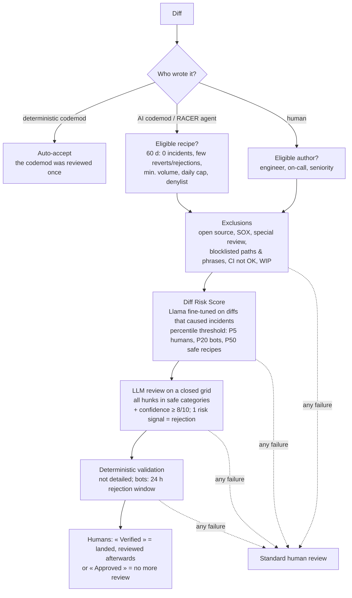

# How they self-approve PRs — detailed analysis (2026)

> Full reading of the primary sources (14/11/2026): Meta RADAR paper, Vercel post (retrieved via the Wayback Machine), Intercom, Rewind, Ona, Tessl, Cloudflare posts.
> Scope: routing, decision, human role, validation, measurement. **Cybersecurity is out of scope.**
> "not specified" = absent from the source. All companies publish their own figures.

---

## 1. One sentence per player

| Player | What they built, in one sentence |
|---|---|
| **Meta RADAR** | A **conjunctive funnel** (eligible source/author → exclusions → ML risk score as a percentile → LLM on a closed grid → validation) where each stage can only send back to a human, and where **each agent "recipe" earns its autonomy through its track record**. |
| **Vercel** | An **LLM LOW/HIGH classifier that must quote the diff before concluding**, biased towards HIGH, framed by 3 hard rules, and rolled out in **3 phases with quantified circuit breakers** set in advance. |
| **Rewind** | A **council of about a dozen specialised reviewers** that produce findings, and a **deterministic verdict engine** (tested code, not a model) that decides, under a **versioned YAML policy** the LLM cannot bypass. |
| **Ona** | **6 objective criteria** codified after observing for 2 weeks the PRs where the human added nothing; **a human always clicks merge**. |
| **Intercom** | An agent with sub-agents that **refuses PRs that are too big**; **the engineer who ships stays accountable** and watches production. |
| **Tessl** | A reviewer tuned to the team's standards, whose **recurring patterns become deterministic checkers**; 6 types of changes always go to a human. |
| **Cloudflare** | Up to 7 reviewers + a coordinator-judge; **deterministic tiers that set review depth** (not eligibility); a published list of **what not to flag**. |

---

## 2. Meta RADAR — the funnel

**Source:** Adams et al., arXiv 2605.30208v2 (June 2026), full text; DRS blog (2025); Mockus et al. TOSEM 2025 for calibration.

**The key pieces**
- **Autonomy is earned per recipe, not per agent.** Each RACER agent runbook has its own 60-day track record, its own daily cap (10 → 2 000 diffs/day), its own risk threshold, and goes on the denylist after an incident. Two recipes that do the same thing can be treated differently depending on their reverts.
- **The risk score is expressed as a percentile** ("the X % least risky diffs") and is set by weighing the share of diffs blocked against the share of incidents caught, over 3–6 months of history — a decision taken with quality, engineering and management. Cautious start, relaxed later (P25 → P50).
- **The LLM does not comment, it classifies.** Safe categories: refactor with no behaviour change, dead code, logs, formatting, docs, imports, tests, static resources. Risk signals: complexity ≥ 4, structural change, logic bug, performance. A single signal = escalation.
- **Per-organisation configuration** (thresholds, allowed sources, deferred review).
- **The author stays in control**: they can always switch back to "Needs Review".

**Figures**: 535 290 diffs reviewed, 331 720 landed, peak 25 000/day; approval rate 60.31 % after moving P25→P50; reverts ÷3 and incidents ÷50 vs non-RADAR diffs (Fisher, very low p-values); median review time −35 %. The authors note that **none of the incidents would have been detected by a human reviewer**.

**What the paper does not say**: prompt, LLM model, content of the "deterministic validation", volumes per stage, who does the deferred review and how quickly, **who is accountable after an approval**. Results are **observational**, diffs not randomly assigned, limited to low-to-medium complexity diffs, in a monorepo with very mature testing and progressive deployment.

---

## 3. Vercel — the classifier that quotes before concluding

**Source:** post of 6 April 2026 (John Phamous), **taken down in under 48 h without explanation**, read in full via the Wayback Machine.

**Starting point (the diagnosis that triggered the project)**: >400 PRs/week on a Next.js monorepo (site, docs, sign-up, dashboards). More than half of PRs approved **without a single comment**, 18 % in **under 5 minutes**, 52 % of approvals without documentation → review was already a rubber stamp.

**The mechanism**
1. **LLM via AI Gateway** (model not specified), input = diff + title + description, ~$0.05/evaluation (~$51/week).
2. **JSON output in an imposed order**: `evidenceQuotes` → `rationale` → `changes` → `riskLevel`. The model must **quote the diff verbatim before it can classify**. No evidence of risk in the code → LOW. "The decision is grounded in the diff, not the PR title."
3. **Deliberate asymmetry**: "A false HIGH costs one unnecessary review. A false LOW lets risky code ship unreviewed." Result: 93 % of "data integrity" PRs in HIGH, 0.4 % of docs PRs.
   - HIGH = authentication, payments, data integrity, infrastructure (+ security).
   - LOW = UI, styles, tests, documentation, refactors, disabled feature flags.
4. **3 hard rules above the LLM**: ≥100 files → HIGH; CODEOWNERS paths → human; untrusted authors (new contributors) → never auto-approved.
5. **Only two actions**: APPROVE or a warning comment. LLM failure or invalid output → normal human review.
6. **The agent's approval satisfies branch protection.** The author can always request a review. Who clicks merge: ambiguous.
7. **"Incorrect?" button** on each evaluation → Datadog log + Slack alert → if confirmed, added to the evals.

**The 3-phase rollout**
| Phase | What happens |
|---|---|
| 1. Silent | Invisible classification, simple informational check; ~3 weeks of prompt iteration until the precision thresholds are met |
| 2. Visible | Risk comment + justification on every PR; challenge via "Incorrect?" |
| 3. Active | LOW PRs are auto-approved |

**Circuit breakers set before the test**: revert > 3× the baseline (1.7 % → 5.1 %), rollback > 3× the baseline (7.2/week), or negative team sentiment.

**Results**
- 58 % of PRs merged without a human reviewer; mean time to merge 29 h → 10.9 h; median 0.5 h vs 2.3 h.
- **671 LOW PRs without review: 0 reverts** (Wilson 95 % upper bound = 0.6 %, below their 1 % threshold).
- **Control group** = LOW PRs reviewed anyway: 2 reverts / 513 (0.39 %).
- Rollbacks 2.8 → 1.9/week, **none caused by an auto-approved PR**; the only incident came from a PR **classified HIGH and approved by a human**.
- Load per reviewer 13 → ~5 PRs/week; large-diff HIGH PRs reviewed 2.7× faster; security issues flagged in review on HIGH PRs 6.3 % → 27.2 % — **the freed-up attention went where it matters**.
- 43 % of LOW PRs still received a voluntary review: review becomes "a choice, not a barrier".

**Limits**: small samples, non-randomised control, internal contradiction (0 % then 0.2 % LOW reverts), duration not given, overall classifier precision not quantified, **accountability when something breaks not specified**. The framework was designed with the Governance/Risk/Compliance lead; key argument: *"Compliance frameworks require a well-defined change management program, not specifically manual peer review"* — the audit trail goes from a click to a full justification per PR.

---

## 4. Rewind, Ona, Intercom, Tessl, Cloudflare

### Rewind — "Diff Vader"
- **Council of ~12 specialists** (correctness, tests, blast radius, reversibility, performance, migrations, CI workflows, dependencies, business domain…), each one switches itself off if the diff does not concern it. Claude Code plugin, can be run locally.
- **The LLM produces findings (severity + confidence); a deterministic verdict engine** ("a few hundred lines of TypeScript, unit-tested, not a model") derives LOW/MEDIUM/HIGH and eligibility from them.
- **Versioned YAML policy, protected by CODEOWNERS**, changed via PR: paths that always go to a human (authentication, authorisation, secrets, encryption, infrastructure, and **anything that changes who can approve**). First version proposed by the AI, audited by humans, repository by repository.
- **Risk does not depend on size**: a migration that locks a table is HIGH even in 3 lines. Size is only an attention cap (>10 000 lines → no AI review).
- **Three verdicts**: REQUEST_CHANGES (the bot waits for the fix), NEEDS_HUMAN (sensitive paths, cap, or `/request-jedi-review`), APPROVE.
- **"Auto-approve is not auto-merge"**: the engineer merges; **a PR written by an agent is never merged without a human, who becomes "the accountable shipping engineer"**.
- Question shared by all reviewers: *"If this is wrong in production, what visible behaviour breaks?"*; flagging naming and comments is forbidden.
- **Validation**: simulation on ~3 000 historical PRs → **1 week in silent mode on 400+ repositories → activation only above 90 % agreement with humans**; stopped if the criteria no longer hold.
- **Loop**: 👍/👎 reactions → weekly digest → 30 min/week from a tech lead → each decision becomes a PR; **the bot never modifies its own prompts or its policy**; exceptions expire after 90 days. Incidents automatically linked to the originating verdict.
- **Figures (directional)**: ~40 % auto-approved (inflated by mechanical version bumps), ~99 % human agreement, 0 reverts/incidents, ~$0.73/PR, ~40 PRs/day.
- Lesson: a second, *blocking* model (Copilot) blocked good PRs → demoted to advisory.

### Ona
- **Observe before deciding**: 2 weeks watching the PRs where the human reviewer added nothing → common profile codified into **6 criteria, all required**: <1 000 lines, no protobuf, no migration, no infra/CI, no auth, no audit/monitoring.
- **Automatic classification, never declared by the author.** The agent also runs the code in a full environment and cross-checks with the tickets.
- **"A human always clicks the merge button"** — that click is the tracked approval event (SOC 2). Any change to the criteria, the prompt **or the model** requires the explicit agreement of the product/engineering lead.
- Results (4 weeks before/after): first approval 2 h 49 → 3.8 min; lead time −74 %; PRs merged +215 %. **% auto-approved, reverts and incidents not published.**
- Lessons: *"The governance model matters more than the AI model"*; *"Human merge authority is the trust anchor"*.

### Intercom
- Agent with sub-agents (problem statement, diff/intent alignment, logic, best practices), follows execution paths, guided by in-house guidelines refined by the engineers.
- **Only published rule: refuses PRs that are too big/complex/broad → forces splitting.**
- **Explicit accountability**: *"The engineer who ships a change is expected to watch it go live… and be ready to roll back. The human who ships the code remains accountable."* Human review possible at any time. Every AI-approved PR is labelled, logged, queryable; auditor involved from the start.
- Validation: replay on historical PRs → pilot of 100+ PRs → 497 autonomous PRs in 4 weeks.
- Figures: 19.2 % auto-approved; 0 reverts in the pilot; revert rate 0.53 % (AI code) vs 5.39 % (human code) in the backend — **careful, this is a comparison of AI code vs human code, not AI approval vs human approval**.
- Lesson: all the big past outages came from changes **approved by humans** — or from causes review cannot see (infra, unforeseen usage, third parties).

### Tessl
- The "75 %" = PRs merged **without a human correcting the agent or debating the engineering** — not strictly zero human review.
- **Patterns flagged repeatedly become deterministic checkers** (pass/fail on each change).
- 6 types of changes always go to a human (only 2 named: privacy, access control).
- Validation: 1 week running in parallel with the old tool on 600+ PRs + external benchmark; terms defined before looking at the results.
- 91 % real findings vs 68 %; 8.5 % of PRs (>5 review rounds) consume 47 % of the budget.

### Cloudflare
- Coordinator (Opus 4.7 / GPT-5.4) + up to 7 specialists (cheaper models for docs/release); configuration changeable on the fly; fallback chains between models.
- **Deterministic tiers that set depth, not eligibility**: Trivial (≤10 lines, 2 agents, $0.20), Lite (≤100 lines, 4 agents, $0.67), Full (7 agents, $1.68).
- The coordinator acts as judge: deduplicates, rejects speculative findings, re-checks in the code. **Lesson: the value lies in what you forbid from being flagged.**
- Verdicts: approved / approved_with_comments → approve; minor_issues → unapprove; significant_concerns → blocks the merge. Human "break glass": 0.6 %.
- 131 246 reviews in 30 days, median 3 min 39, $1.19 on average. **Who merges and auto-approval rate: not specified.** *"This isn't a replacement for human code review, at least not yet."*

---

## 5. Comparison table

| | Who decides eligibility | Hard exclusions | Role of the LLM | Who merges / accountable | Validation before activation | Safety measurement |
|---|---|---|---|---|---|---|
| **Meta** | Funnel: source, author, recipe, ML score | Open source, SOX, blocklisted paths/phrases, CI | Classifies each hunk on a closed grid, ≥8/10 | Author; accountability not specified | Track record per recipe, thresholds gradually relaxed | Reverts ÷3, incidents ÷50 vs non-RADAR (observational) |
| **Vercel** | LLM + 3 hard rules | ≥100 files, CODEOWNERS, untrusted authors | Quotes the diff then classifies LOW/HIGH | Ambiguous; not specified | Silent → visible → active, circuit breakers | Non-randomised control, Wilson, 0/671 |
| **Rewind** | Deterministic engine on LLM findings | CODEOWNERS YAML (auth, secrets, infra, governance), >10k lines | Findings with severity + confidence | **Human merges; agent PR ⇒ human accountable** | Replay of 3 000 PRs, silent 1 wk, **≥90 % agreement** | 99 % agreement, 0 reverts, incidents linked to the verdict |
| **Ona** | 6 objective criteria | Size, protobuf, migrations, infra/CI, auth, audit | Review + criterion-by-criterion justification | **Human always clicks** | 2 wks of observation | Not published |
| **Intercom** | Agent's judgement | Large PRs | Sub-agents | **Shipper accountable, watches production** | Replay + 100-PR pilot | Revert rate AI code vs human code |
| **Tessl** | Adjustable policy | 6 types (privacy, access…) | Lenses + checkers | Not specified | Parallel run on 600 PRs | Findings precision |
| **Cloudflare** | Tiers = depth only | — | Coordinator-judge, verdict scale | Not specified | Not published | Not published |

---

## 6. The common pattern (what works everywhere)

1. **A deterministic floor the LLM cannot cross**: paths/types of changes that always go to a human, size cap, unqualified authors/recipes. Ideally **versioned and protected** (Rewind: YAML under CODEOWNERS).
2. **The LLM provides inputs, not the final decision**: quotes from the diff (Vercel), classification on a closed grid (Meta), scored findings (Rewind) → **a deterministic rule or engine decides**.
3. **Deliberate asymmetry**: erring towards "human" costs a review; erring towards "auto" costs an incident. Any failure or doubt → human.
4. **Approving ≠ merging**: a human merges and/or stays accountable for the production release (Ona, Rewind, Intercom).
5. **Progressive activation**: replay of history → silent mode → visible mode → active mode, with **agreement thresholds** (90 % at Rewind) and **circuit breakers** (3× the baseline at Vercel) set in advance.
6. **Human correction loop**: "Incorrect?", 👍/👎, weekly digest, recurring patterns → deterministic rules; **the system never rewrites its own policy**.
7. **Continuous measurement**: reverts, rollbacks/incidents linked to the originating PR, human agreement rate, cost, lead times.
8. **Honest starting point**: before the project, human review was often already a rubber stamp (Vercel: >50 % without comment, 18 % in <5 min).

## 7. What is missing everywhere — and what our concept can bring

| Gap | Observation | Our answer |
|---|---|---|
| **Blurry accountability** | Meta and Vercel do not say who answers for an auto-approved PR that breaks; Cloudflare and Tessl do not say who merges | A **named human per risk level**, who signs a **bounded attestation** |
| **No trace of what the human checked** | The "merge" or "approve" click does not say what was looked at | The attestation lists what is **proven**, what the human **read**, what **was not checked** |
| **No link to the requirement** | All of them judge the risk of the diff, none checks that it **does what was asked** | **Requirement → change → evidence traceability**; code with no requirement flagged |
| **Nothing on what the AI refuses to decide** | The LLM classifies or escalates, with no structured reason | **Refusal register**: reserved decision, reason, owner |
| **Biased measurement** | Non-randomised controls everywhere (Meta, Vercel, Intercom) | **Randomly drawn sample** of auto-approved PRs, re-read by a human (counter-review) |
| **No "large agentic change" case** | All limit auto-approval to small diffs; the 237-file case is handled by no one | **Reading contract**: split a large diff into mechanically provable zones (e.g. regenerated snapshots) and zones to read |

## 8. Direct transposition to our demo (MessagePack branches)

- **Versioned policy** `review-policy.yaml`: paths that always go to a human (public API, new MsgPack0xx diagnostics, generator), size cap, safe categories (snapshots whose only change is mechanical, docs, added tests).
- **Classifier that quotes** (Vercel format) + **closed grid per hunk** (Meta format) → **deterministic verdict engine** (Rewind format).
- **Historical replay**: run the chain on the 4 branches + seeded bugs, compare with a human's verdict → **agreement rate** and activation threshold (90 %).
- **Simulated silent mode**: show what the system *would have* decided before letting it decide.
- **Circuit breakers** shown in the dashboard (revert > 3× the baseline, agreement < 90 %).
- **Named human**: the CODEOWNERS owner of the path concerned signs the attestation.
